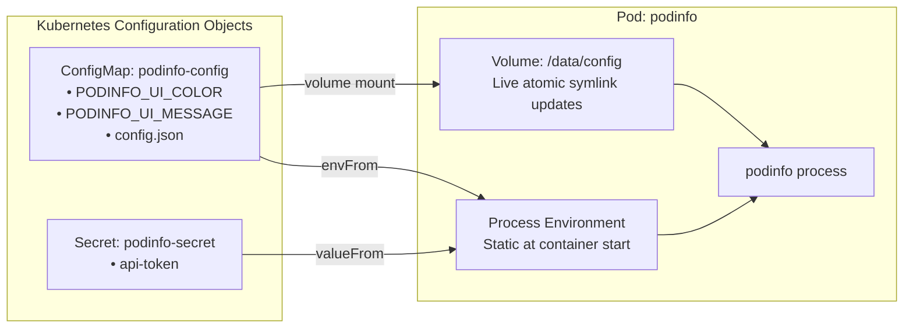

# Lab CKAD-04 — Workload Configuration & Secrets

In this lab, you configure `podinfo` dynamically using **ConfigMaps** and **Secrets**. You will explore the two primary ways containers consume external configuration: **environment variables** and **mounted configuration files**. You will see why values set imperatively survive `kubectl apply`, watch a mounted file update without a Pod restart, and diagnose a classic container startup failure: `CreateContainerConfigError`.

Concepts: [[Kubernetes/concepts/L05-config-storage/01-config-maps|ConfigMaps]], [[Kubernetes/concepts/L05-config-storage/02-secrets|Secrets]] and [[Kubernetes/concepts/L05-config-storage/03-volumes|Volume Types]].

Tested 2026-10-13 on kind v0.33.0 with Kubernetes v1.37.0.



---

## 1. Prerequisites & Starting State

- Working `k8s-lab` cluster.
- `podinfo` deployment in the exit state of **[[Kubernetes/labs/ckad/03-updates-and-rollbacks|Lab CKAD-03]]**, which still has `PODINFO_UI_COLOR` and `PODINFO_UI_MESSAGE` set directly on the container. Step 2 depends on that.

---

## 2. Configuration & Secret Manifests

Create a file named `podinfo-config.yaml`:

```yaml
apiVersion: v1
kind: ConfigMap
metadata:
  name: podinfo-config
  namespace: default
data:
  PODINFO_UI_COLOR: "#4b7bec"
  PODINFO_UI_MESSAGE: "Configured via ConfigMap!"
  config.json: |
    {
      "environment": "laboratory",
      "features": {
        "cache": true,
        "telemetry": true
      }
    }
---
apiVersion: v1
kind: Secret
metadata:
  name: podinfo-secret
  namespace: default
type: Opaque
stringData:
  api-token: "k8s-lab-secret-auth-token"
```

Apply both objects to your cluster:

```bash
kubectl apply -f podinfo-config.yaml
```

Verify creation:

```bash
kubectl get cm podinfo-config
kubectl get secret podinfo-secret
```

---

## 3. Step-by-Step Execution: Consuming Config in Workloads

### Step 1: Update Deployment to consume configuration and files

Save the updated deployment as `podinfo-with-config.yaml`:

```yaml
apiVersion: apps/v1
kind: Deployment
metadata:
  name: podinfo
  namespace: default
spec:
  replicas: 2
  selector:
    matchLabels:
      app.kubernetes.io/name: podinfo
  template:
    metadata:
      labels:
        app.kubernetes.io/name: podinfo
    spec:
      containers:
        - name: podinfo
          image: ghcr.io/stefanprodan/podinfo:6.7.1
          imagePullPolicy: IfNotPresent
          ports:
            - name: http
              containerPort: 9898
          env:
            # Individual key reference from a Secret
            - name: PODINFO_TOKEN
              valueFrom:
                secretKeyRef:
                  name: podinfo-secret
                  key: api-token
          # Every key of the ConfigMap as an environment variable
          envFrom:
            - configMapRef:
                name: podinfo-config
          # One key of the ConfigMap as a file
          volumeMounts:
            - name: config-volume
              mountPath: /data/config
              readOnly: true
          livenessProbe:
            httpGet:
              path: /healthz
              port: http
            initialDelaySeconds: 2
            periodSeconds: 10
          readinessProbe:
            httpGet:
              path: /readyz
              port: http
            initialDelaySeconds: 2
            periodSeconds: 5
          resources:
            requests:
              cpu: 50m
              memory: 32Mi
            limits:
              cpu: 250m
              memory: 128Mi
      volumes:
        - name: config-volume
          configMap:
            name: podinfo-config
            items:
              - key: config.json
                path: config.json
```

Apply the updated deployment:

```bash
kubectl apply -f podinfo-with-config.yaml
kubectl rollout status deployment/podinfo --timeout=120s
```

### Step 2: Find out why the ConfigMap values did not arrive

```bash
kubectl exec deploy/podinfo -- env | grep -E "PODINFO_UI_|PODINFO_TOKEN"
```

```
PODINFO_TOKEN=k8s-lab-secret-auth-token
PODINFO_UI_COLOR=#16a085
PODINFO_UI_MESSAGE=v2 rollout successful!
```

The Secret arrived, but the colour and message are still the ones from Lab CKAD-03, not the ConfigMap's. Two rules combine to produce this:

1. **`kubectl apply` only removes what it applied before.** The two variables were added with `kubectl set env`, so they are not in the last-applied record. Applying a file that does not mention them leaves them in place.
2. **An explicit `env` entry wins over `envFrom`** when both define the same name.

Look at the live object to confirm:

```bash
kubectl get deployment podinfo -o jsonpath='{.spec.template.spec.containers[0].env[*].name}{"\n"}'
```

```
PODINFO_TOKEN PODINFO_UI_COLOR PODINFO_UI_MESSAGE
```

Remove the two stale entries (a trailing `-` deletes a variable) and wait for the rollout:

```bash
kubectl set env deployment/podinfo PODINFO_UI_COLOR- PODINFO_UI_MESSAGE-
kubectl rollout status deployment/podinfo --timeout=120s
```

### Step 3: Verify environment variables, the application and the mounted file

```bash
kubectl exec deploy/podinfo -- env | grep -E "PODINFO_UI_|PODINFO_TOKEN"
kubectl exec deploy/podinfo -- wget -qO- localhost:9898/api/info | grep -E 'color|message'
kubectl exec deploy/podinfo -- cat /data/config/config.json
```

```
PODINFO_TOKEN=k8s-lab-secret-auth-token
PODINFO_UI_COLOR=#4b7bec
PODINFO_UI_MESSAGE=Configured via ConfigMap!
  "color": "#4b7bec",
  "message": "Configured via ConfigMap!",
{
  "environment": "laboratory",
  "features": {
    "cache": true,
    "telemetry": true
  }
}
```

The second command matters: it shows the application using the value, not only the variable being present.

> [!note] The probes are still there
> `podinfo-with-config.yaml` repeats the liveness and readiness probes from Lab CKAD-02. Had the file left them out, `kubectl apply` would have **removed** them, because they were in the last-applied record. The file also omits the `command` from CKAD-02, so that field is removed and the image's default command runs. Apply deletes fields it owns and ignores fields it does not.

### Step 4: Mounted files update, environment variables do not

- **Environment variables** are fixed when the container process starts. They never change in a running container.
- **ConfigMap volumes** are refreshed by the kubelet, which swaps a symlink (`..data`) to the new content. The file changes without a restart. A volume mounted with `subPath` is the exception and is never refreshed.

Change both a file key and a variable key in the ConfigMap:

```bash
POD_NAME=$(kubectl get pods -l app.kubernetes.io/name=podinfo -o jsonpath='{.items[0].metadata.name}')

kubectl patch configmap podinfo-config --type merge \
  -p '{"data":{"config.json":"{\n  \"environment\": \"production-simulated\"\n}","PODINFO_UI_MESSAGE":"changed after start"}}'
```

Wait for the file to change instead of sleeping for a guessed time. It took 40 seconds in the test run and can take up to about a minute and a half:

```bash
until kubectl exec "$POD_NAME" -- cat /data/config/config.json | grep -q production; do sleep 5; done

kubectl exec "$POD_NAME" -- cat /data/config/config.json
kubectl exec "$POD_NAME" -- env | grep PODINFO_UI_MESSAGE
kubectl get pod "$POD_NAME"
```

```
{
  "environment": "production-simulated"
}
PODINFO_UI_MESSAGE=Configured via ConfigMap!
NAME                       READY   STATUS    RESTARTS   AGE
podinfo-695bc4f7dc-mdn8n   1/1     Running   0          4m51s
```

The file changed, the variable did not, and `RESTARTS` is still `0`. A Pod created from now on gets the new message; to push it to the running ones, restart them with `kubectl rollout restart deployment/podinfo`.

---

## 4. Controlled Failure Scenario: Diagnosing `CreateContainerConfigError`

What happens when a manifest references a configuration key that does not exist?

### Trigger the failure:

Patch the Deployment to require a nonexistent key from the secret:

```bash
kubectl patch deployment podinfo --type json -p='[
  {"op": "add", "path": "/spec/template/spec/containers/0/env/-", "value": {
    "name": "DB_PASSWORD",
    "valueFrom": {
      "secretKeyRef": {
        "name": "podinfo-secret",
        "key": "missing-password-key"
      }
    }
  }}
]'
```

### Observe the symptom:

Check the Pod status:

```bash
kubectl get pods -l app.kubernetes.io/name=podinfo
```

**Observed output:**

```
NAME                       READY   STATUS                       RESTARTS   AGE
podinfo-575d45d4fb-dn6vk   0/1     CreateContainerConfigError   0          12s
podinfo-695bc4f7dc-mdn8n   1/1     Running                      0          2m56s
podinfo-695bc4f7dc-mkcp8   1/1     Running                      0          2m51s
```

### Root Cause Diagnosis:

Inspect the failed Pod:

```bash
FAILED_POD=$(kubectl get pods -l app.kubernetes.io/name=podinfo --field-selector=status.phase=Pending -o jsonpath='{.items[0].metadata.name}')
kubectl describe pod "$FAILED_POD" | grep -A 5 "Events:"
```

**Diagnostic event:**

```
Warning  Failed     10s (x2 over 11s)  kubelet  spec.containers{podinfo}: Error: couldn't find key missing-password-key in Secret default/podinfo-secret
```

**Key Takeaway:**
By default, `secretKeyRef` and `configMapKeyRef` are strict. If the object or key is missing, kubelet fails to start the container. To make a configuration key optional, set `optional: true` in the key reference:

```yaml
valueFrom:
  secretKeyRef:
    name: podinfo-secret
    key: missing-password-key
    optional: true
```

### Recovery:

Re-applying the file looks like the obvious fix, and it does not work:

```bash
kubectl apply -f podinfo-with-config.yaml
kubectl get deployment podinfo -o jsonpath='{.spec.template.spec.containers[0].env[*].name}{"\n"}'
```

```
deployment.apps/podinfo configured
PODINFO_TOKEN DB_PASSWORD
```

`DB_PASSWORD` is still there, for the same reason as in step 2: it was added by a patch, so `kubectl apply` does not own it and will not delete it. Remove the entry explicitly and confirm it has gone:

```bash
kubectl set env deployment/podinfo DB_PASSWORD-
kubectl rollout status deployment/podinfo --timeout=120s
kubectl get deployment podinfo -o jsonpath='{.spec.template.spec.containers[0].env[*].name}{"\n"}'
kubectl get pods -l app.kubernetes.io/name=podinfo
```

```
PODINFO_TOKEN
```

`kubectl rollout undo deployment/podinfo` would also have worked here, because the bad change was the most recent revision.

---

## 5. Exit State

The next lab expects:

- Deployment `default/podinfo` with two ready replicas, `env` containing only `PODINFO_TOKEN`, readiness probe on `/readyz`;
- ConfigMap `podinfo-config` and Secret `podinfo-secret` in `default`;
- no Pod in `CreateContainerConfigError`.

---

## Further reading

- [Configure a Pod to use a ConfigMap](https://kubernetes.io/docs/tasks/configure-pod-container/configure-pod-configmap/)
- [Secrets](https://kubernetes.io/docs/concepts/configuration/secret/)
- [Declarative management with configuration files](https://kubernetes.io/docs/tasks/manage-kubernetes-objects/declarative-config/), including how apply calculates deletions

## Next Lab

Now that the application is configured, proceed to **[[Kubernetes/labs/ckad/05-services-and-dns|Lab CKAD-05 — Services & DNS]]** to expose `podinfo` across the cluster, or return to the [[Kubernetes/certifications/ckad|CKAD Track]].
