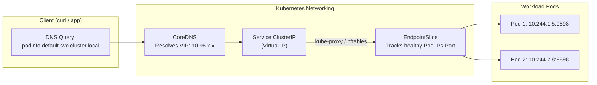

# Lab CKAD-05 — Services & DNS

In this lab, you make `podinfo` discoverable and accessible across the cluster. You will create a **ClusterIP Service**, trace how the kube-proxy and **EndpointSlice** controller map virtual service IPs to real pod IPs, verify intra-cluster DNS resolution, diagnose a zero-endpoint selector mismatch, and expose the service to your host machine.

Concepts: [[Kubernetes/concepts/L04-services-networking/02-services|Services]], [[Kubernetes/concepts/L04-services-networking/03-dns|DNS in Kubernetes]], [[Kubernetes/concepts/L04-services-networking/08-endpoint-slices|EndpointSlices]] and [[Kubernetes/guides/troubleshooting/service-unreachable|Service Unreachable]].

Tested 2026-10-13 on kind v0.33.0 with Kubernetes v1.37.0.



---

## 1. Prerequisites & Starting State

- Working `k8s-lab` cluster.
- `podinfo` deployment in the exit state of **[[Kubernetes/labs/ckad/04-configuration|Lab CKAD-04]]**: two ready replicas, with no other Pod carrying the label `app.kubernetes.io/name=podinfo`.
- The cluster was created from the current [[Kubernetes/labs/index|kind configuration]], which maps host port `30080` to the control-plane node. Section 5 needs that mapping.

---

## 2. Service Manifest

Save the following YAML as `podinfo-service.yaml`:

```yaml
apiVersion: v1
kind: Service
metadata:
  name: podinfo
  namespace: default
  labels:
    app.kubernetes.io/name: podinfo
spec:
  type: ClusterIP
  selector:
    app.kubernetes.io/name: podinfo
  ports:
    - name: http
      port: 9898
      targetPort: http
      protocol: TCP
```

Apply the service:

```bash
kubectl apply -f podinfo-service.yaml
```

---

## 3. Step-by-Step Execution

### Step 1: Inspect the Virtual IP (ClusterIP)

```bash
kubectl get service podinfo -o wide
```

**Expected output:**

```
NAME      TYPE        CLUSTER-IP     EXTERNAL-IP   PORT(S)    AGE   SELECTOR
podinfo   ClusterIP   10.96.9.254    <none>        9898/TCP   10s   app.kubernetes.io/name=podinfo
```

Notice:

- The ClusterIP is a **virtual IP** that `kube-proxy` implements with packet-rewriting rules on every node (`iptables` on this kind cluster; `nftables` and IPVS are the other modes). Your address will differ.
- No network interface carries it. It answers only on the Service's ports, so do not use `ping` to test a Service.

### Step 2: Inspect EndpointSlices

The **EndpointSlice** controller records which Pod IPs back the Service:

```bash
kubectl get endpointslices -l kubernetes.io/service-name=podinfo -o wide
```

**Expected output:**

```
NAME            ADDRESSTYPE   PORTS   ENDPOINTS                     AGE
podinfo-vrp8c   IPv4          9898    10.244.1.8,10.244.2.5         30s
```

Check the individual Pod IPs and compare:

```bash
kubectl get pods -l app.kubernetes.io/name=podinfo -o custom-columns=NAME:.metadata.name,IP:.status.podIP,NODE:.spec.nodeName
```

The addresses in the EndpointSlice are the IPs of the Pods that match the selector **and** are Ready.

### Step 3: Test DNS Resolution and Service Routing

Start a client Pod that stays running, so the following steps can reuse it:

```bash
kubectl run curl-client --image=curlimages/curl:8.10.1 --restart=Never --command -- sleep 3600
kubectl wait --for=condition=Ready pod/curl-client --timeout=90s

kubectl exec curl-client -- cat /etc/resolv.conf
kubectl exec curl-client -- nslookup podinfo.default.svc.cluster.local
```

```
search default.svc.cluster.local svc.cluster.local cluster.local
nameserver 10.96.0.10
options ndots:5

Server:		10.96.0.10
Address:	10.96.0.10:53

Name:	podinfo.default.svc.cluster.local
Address: 10.96.9.254
```

The `search` line is why the short name `podinfo` works from a Pod in the same namespace, and why a Pod in another namespace must use `podinfo.default`. If you run `nslookup podinfo` with the short name, BusyBox-style `nslookup` prints an `NXDOMAIN` line for each search domain that does not match and exits non-zero even though one lookup succeeded. That noise is not a DNS fault.

Send several requests through the Service:

```bash
kubectl exec curl-client -- sh -c \
  'for i in $(seq 1 6); do curl -s http://podinfo:9898/api/info | grep hostname; done'
```

```
  "hostname": "podinfo-695bc4f7dc-mkcp8",
  "hostname": "podinfo-695bc4f7dc-mkcp8",
  "hostname": "podinfo-695bc4f7dc-mkcp8",
  "hostname": "podinfo-695bc4f7dc-mkcp8",
  "hostname": "podinfo-695bc4f7dc-mkcp8",
  "hostname": "podinfo-695bc4f7dc-mdn8n",
```

Both Pods answer, but not in turn. `kube-proxy` picks a backend at random for each new connection, so a short run can be lopsided. Do not expect strict alternation.

---

## 4. Controlled Failure Scenarios: Three Ways to Lose a Backend

All three produce a Service that resolves in DNS and still does not answer. The evidence that separates them is in the EndpointSlice.

### 4a. Selector typo: no endpoints

```bash
kubectl patch service podinfo -p '{"spec":{"selector":{"app.kubernetes.io/name":"podinfo-typo"}}}'

kubectl exec curl-client -- curl -sS -m 5 http://podinfo:9898/
kubectl get endpointslices -l kubernetes.io/service-name=podinfo
kubectl describe service podinfo | grep -E 'Selector|Endpoints'
```

```
curl: (7) Failed to connect to podinfo port 9898 after 0 ms: Could not connect to server
command terminated with exit code 7

NAME            ADDRESSTYPE   PORTS     ENDPOINTS   AGE
podinfo-vrp8c   IPv4          <unset>   <unset>     9s

Selector:                 app.kubernetes.io/name=podinfo-typo
Endpoints:
```

On this cluster the connection is **refused immediately**: `kube-proxy` installs a reject rule for a Service with no endpoints. Other dataplanes may drop the packet instead, which shows up as a timeout. Either way, an empty `Endpoints` line plus a selector that matches no Pod is the diagnosis.

Repair it and confirm:

```bash
kubectl apply -f podinfo-service.yaml
kubectl describe service podinfo | grep "Endpoints:"
```

```
Endpoints:                10.244.2.5:9898,10.244.1.8:9898
```

### 4b. Wrong targetPort: endpoints exist, nothing listens

```bash
kubectl patch service podinfo --type json \
  -p '[{"op":"replace","path":"/spec/ports/0/targetPort","value":9899}]'

kubectl describe service podinfo | grep -E 'TargetPort|Endpoints'
kubectl exec curl-client -- curl -sS -m 5 http://podinfo:9898/
```

```
TargetPort:               9899/TCP
Endpoints:                10.244.2.5:9899,10.244.1.8:9899
curl: (7) Failed to connect to podinfo port 9898 after 0 ms: Could not connect to server
```

Same client error, different evidence: the endpoints are populated, but with a port the container does not listen on. Compare `TargetPort` with the container's `containerPort`. Repair with `kubectl apply -f podinfo-service.yaml`.

### 4c. Unready Pod: endpoint present but not ready

`podinfo` can switch its own readiness off. Do it for one Pod:

```bash
POD_NAME=$(kubectl get pods -l app.kubernetes.io/name=podinfo -o jsonpath='{.items[0].metadata.name}')
POD_IP=$(kubectl get pod "$POD_NAME" -o jsonpath='{.status.podIP}')

kubectl exec curl-client -- curl -s -X POST "http://$POD_IP:9898/readyz/disable"
kubectl wait --for=condition=Ready=false pod/"$POD_NAME" --timeout=30s

kubectl get pods -l app.kubernetes.io/name=podinfo
kubectl get endpointslices -l kubernetes.io/service-name=podinfo \
  -o jsonpath='{range .items[*].endpoints[*]}{.addresses[0]} ready={.conditions.ready}{"\n"}{end}'
```

```
NAME                       READY   STATUS    RESTARTS   AGE
podinfo-695bc4f7dc-mdn8n   0/1     Running   0          6m25s
podinfo-695bc4f7dc-mkcp8   1/1     Running   0          6m20s

10.244.2.5 ready=false
10.244.1.8 ready=true
```

The Pod is `Running` with `RESTARTS 0` and `0/1` ready. A failing **readiness** probe takes a Pod out of the Service without restarting it; a failing **liveness** probe restarts the container. The Service keeps working on the remaining Pod. Had both been unready, the client would have seen the same refusal as in 4a.

Restore it:

```bash
kubectl exec curl-client -- curl -s -X POST "http://$POD_IP:9898/readyz/enable"
kubectl wait --for=condition=Ready pod/"$POD_NAME" --timeout=30s
```

---

## 5. Reaching the Service from the Host with a NodePort

A NodePort opens the same port on every node. Three separate mechanisms are easy to confuse here:

| Mechanism                | What it does                                               | Where it is set                        |
| :----------------------- | :--------------------------------------------------------- | :------------------------------------- |
| NodePort                 | `kube-proxy` forwards `<any node IP>:30080` to the Service | Service `type: NodePort`               |
| kind `extraPortMappings` | Docker publishes a node container's port on your machine   | kind cluster configuration             |
| hostPort                 | One Pod binds a port on the node it runs on                | Pod `ports[].hostPort` (not used here) |

Your machine cannot reach a kind node's ports unless Docker publishes them. The lab cluster publishes `30080` on the control-plane node, so a NodePort of `30080` is reachable at `localhost:30080`.

```bash
kubectl create service nodeport podinfo-nodeport --tcp=9898:http --node-port=30080 \
  --dry-run=client -o yaml \
  | kubectl set selector --local -f - app.kubernetes.io/name=podinfo -o yaml \
  | kubectl apply -f -

curl -s -m 5 http://127.0.0.1:30080/api/info | grep -E 'hostname|message'
```

```
service/podinfo-nodeport created
  "hostname": "podinfo-695bc4f7dc-mkcp8",
  "message": "Configured via ConfigMap!",
```

`kubectl create service` sets the selector to `app=<name>`, which would match nothing here, so the pipeline replaces it before applying. If `curl` fails, the cluster was probably created without the `30080` mapping; `kubectl port-forward service/podinfo 9898:9898` works on any cluster and any operating system.

A NodePort number is allocated once for the whole cluster, in every namespace. Release it now, because [[Kubernetes/labs/ckad/09-ingress|Lab CKAD-09]] gives the same port to the ingress controller:

```bash
kubectl delete service podinfo-nodeport
kubectl delete pod curl-client --wait=false
```

---

## 6. Exit State

The next lab expects:

- Deployment `default/podinfo` with two ready replicas;
- Service `default/podinfo` (ClusterIP, port 9898) with two ready endpoints;
- no `podinfo-nodeport` Service and no `curl-client` Pod.

```bash
kubectl get endpointslices -l kubernetes.io/service-name=podinfo
kubectl get service -A | grep 30080 || echo "NodePort 30080 is free"
```

---

## Further reading

- [Service](https://kubernetes.io/docs/concepts/services-networking/service/)
- [DNS for Services and Pods](https://kubernetes.io/docs/concepts/services-networking/dns-pod-service/)
- [Debug Services](https://kubernetes.io/docs/tasks/debug/debug-application/debug-service/)

## Next Lab

Keep the `podinfo` Deployment and Service running, then proceed to **[[Kubernetes/labs/ckad/06-observability-and-troubleshooting|Lab CKAD-06 — Observability & Troubleshooting]]**, or return to the [[Kubernetes/certifications/ckad|CKAD Track]]. Routing by host and path is covered in [[Kubernetes/labs/ckad/09-ingress|Lab CKAD-09 — Ingress]].
