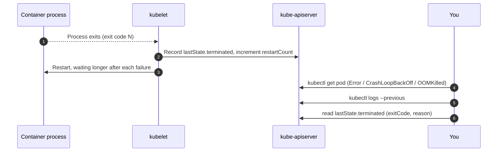

# Lab CKAD-06 — Observability & Troubleshooting

In this lab you collect evidence from a running workload and use it to tell three failures apart: a container that exits once, one that crashes on every start, and one the kernel kills for using too much memory. You install `metrics-server`, read application and resource metrics, attach an **ephemeral debug container** with `kubectl debug`, and read previous logs and termination state.

Concepts: [[Kubernetes/concepts/L08-operations/02-kubectl-debug|kubectl Debug Toolkit]], [[Kubernetes/concepts/L08-operations/04-metrics-sources|Metrics Sources]] and [[Kubernetes/guides/troubleshooting/crashloop-backoff|CrashLoopBackOff]].

Tested 2026-10-13 on kind v0.33.0 with Kubernetes v1.37.0.



---

## 1. Prerequisites & Starting State

- Working `k8s-lab` cluster.
- `podinfo` Deployment and ClusterIP Service in the exit state of **[[Kubernetes/labs/ckad/05-services-and-dns|Lab CKAD-05]]**.

```bash
kubectl get deployment,svc podinfo
```

---

## 2. Metrics

### Step 1: Install metrics-server

`kubectl top` and the HorizontalPodAutoscaler both read the `metrics.k8s.io` API, which `metrics-server` provides. kind does not ship it. Install a pinned release and allow it to skip verification of the kubelet's serving certificate, which on kind is self-signed:

```bash
kubectl apply -f https://github.com/kubernetes-sigs/metrics-server/releases/download/v0.9.0/components.yaml

kubectl patch deployment metrics-server -n kube-system --type json \
  -p '[{"op":"add","path":"/spec/template/spec/containers/0/args/-","value":"--kubelet-insecure-tls"}]'

kubectl rollout status -n kube-system deployment/metrics-server --timeout=180s
```

> [!warning] `--kubelet-insecure-tls` is for lab clusters
> On a real cluster, give the kubelets serving certificates signed by the cluster CA instead. The exam clusters already have a working metrics API where a task needs one.

The first samples take up to a minute. Wait for them instead of hiding the error:

```bash
until kubectl top nodes >/dev/null 2>&1; do sleep 5; done

kubectl top nodes
kubectl top pods -l app.kubernetes.io/name=podinfo
```

```
NAME                    CPU(cores)   CPU(%)   MEMORY(bytes)   MEMORY(%)
k8s-lab-control-plane   179m         2%       664Mi           4%
k8s-lab-worker          33m          0%       167Mi           1%
k8s-lab-worker2         316m         5%       231Mi           1%

NAME                       CPU(cores)   MEMORY(bytes)
podinfo-695bc4f7dc-mdn8n   1m           15Mi
podinfo-695bc4f7dc-mkcp8   1m           15Mi
```

Useful variants: `kubectl top pods -A --sort-by=memory`, and `kubectl top pod <pod> --containers`.

### Step 2: Read the application's own metrics

`podinfo` publishes Prometheus metrics on `/metrics`. Start a port-forward and leave it running for section 4:

```bash
kubectl port-forward svc/podinfo 9898:9898 >/dev/null 2>&1 &
PF_PID=$!
sleep 3

curl -s http://127.0.0.1:9898/metrics | grep -E "^http_requests_total|^process_cpu_seconds_total"
```

```
http_requests_total{status="200"} 162
process_cpu_seconds_total 0.14
```

These two sources answer different questions. `kubectl top` reports what the kubelet measures for any container. `/metrics` reports what the application chooses to count, and nothing collects it unless you run Prometheus or a similar scraper.

---

## 3. Ephemeral Debug Containers with `kubectl debug`

A minimal image often has no shell, `ps` or `netstat`. An **ephemeral container** adds a tools container to a running Pod without restarting it.

```bash
POD_NAME=$(kubectl get pods -l app.kubernetes.io/name=podinfo -o jsonpath='{.items[0].metadata.name}')

kubectl debug -it "$POD_NAME" --image=busybox:1.36 --target=podinfo -- sh
```

Inside the debug shell:

```sh
ps aux
netstat -tln
exit
```

```
PID   USER     TIME  COMMAND
    1 100       0:00 ./podinfo
  100 root      0:00 sh
  113 root      0:00 ps aux

Proto Recv-Q Send-Q Local Address           Foreign Address         State
tcp        0      0 :::9898                 :::*                    LISTEN
```

`--target=podinfo` joins the process namespace of that container, which is why you can see `./podinfo` as PID 1. Every container in a Pod shares the network namespace, so `netstat` shows the application's listener with or without `--target`. Note the `USER` column: `podinfo` runs as UID 100, not root.

`kubectl get pod "$POD_NAME"` still shows `RESTARTS 0`. An ephemeral container cannot be removed from a Pod; it goes when the Pod is replaced.

---

## 4. Failure 1: A Container That Exits Once

`podinfo` 6.7.1 has a fault-injection endpoint, `GET /panic`, that logs a message and calls `os.Exit(255)`. Send the request through the port-forward from section 2:

```bash
curl -s -m 5 -o /dev/null -w '%{http_code}\n' http://127.0.0.1:9898/panic
kill $PF_PID
kubectl get pods -l app.kubernetes.io/name=podinfo
```

```
000
NAME                       READY   STATUS    RESTARTS     AGE
podinfo-695bc4f7dc-mdn8n   1/1     Running   0            8m54s
podinfo-695bc4f7dc-mkcp8   1/1     Running   1 (7s ago)   8m49s
```

`000` means the connection closed without an HTTP response, because the process died while handling the request. A `POST` to the same path returns `405 Method Not Allowed` and kills nothing, so check the method if no Pod restarts. The port-forward went through the Service to one Pod, and that Pod now has `RESTARTS 1`.

The container is already running again, so `kubectl logs` shows the new process. The evidence is in the **previous** container and in `lastState`:

```bash
RESTARTED=$(kubectl get pods -l app.kubernetes.io/name=podinfo \
  -o jsonpath='{range .items[?(@.status.containerStatuses[0].restartCount>0)]}{.metadata.name}{end}')

kubectl logs "$RESTARTED" --previous | tail -n 1
kubectl get pod "$RESTARTED" -o jsonpath='{.status.containerStatuses[0].lastState.terminated}' | jq .
```

```
{"level":"info","ts":"2026-10-13T10:34:18.323Z","caller":"http/panic.go:14","msg":"Panic command received"}
```

```json
{
  "containerID": "containerd://f411fdc7...",
  "exitCode": 255,
  "finishedAt": "2026-10-13T10:34:18Z",
  "reason": "Error",
  "startedAt": "2026-10-13T10:25:37Z"
}
```

One exit followed by a healthy restart is **not** `CrashLoopBackOff`. The Pod never showed that status, and nothing needs repairing. `restartPolicy: Always` did its job.

---

## 5. Failure 2: A Container That Crashes on Every Start

A crash loop needs a fault that is still there after the restart. Create a workload that refuses to start without a setting:

```bash
kubectl create deployment orders --image=busybox:1.36 -- sh -c \
  'if [ -z "$DB_URL" ]; then echo "FATAL: DB_URL is not set" >&2; exit 3; fi; echo "connected to $DB_URL"; sleep 3600'

sleep 45
kubectl get pods -l app=orders
```

```
NAME                      READY   STATUS   RESTARTS      AGE
orders-79cf4848dd-f5jr2   0/1     Error    3 (32s ago)   45s
```

The status alternates between `Error` (the container has just exited) and `CrashLoopBackOff` (the kubelet is waiting before the next attempt). The wait doubles after each failure up to a cap, so the gaps grow.

Now diagnose it as if you did not know the cause:

```bash
ORDERS_POD=$(kubectl get pods -l app=orders -o jsonpath='{.items[0].metadata.name}')

kubectl logs "$ORDERS_POD"
kubectl get pod "$ORDERS_POD" -o jsonpath='{.status.containerStatuses[0].lastState.terminated.exitCode}{"\n"}'
kubectl describe pod "$ORDERS_POD" | grep -A 8 "Events:"
```

```
FATAL: DB_URL is not set
3
Events:
  Type     Reason     Age               From               Message
  ----     ------     ----              ----               -------
  Normal   Scheduled  46s               default-scheduler  Successfully assigned default/orders-79cf4848dd-f5jr2 to k8s-lab-worker2
  Normal   Pulled     3s (x4 over 45s)  kubelet            spec.containers{busybox}: Container image "busybox:1.36" already present on machine ...
  Normal   Created    3s (x4 over 45s)  kubelet            spec.containers{busybox}: Container created
  Normal   Started    3s (x4 over 45s)  kubelet            spec.containers{busybox}: Container started
  Warning  BackOff    2s (x3 over 43s)  kubelet            spec.containers{busybox}: Back-off restarting failed container busybox in pod orders-79cf4848dd-f5jr2
```

- `Started` appears four times: the image is fine and the container does start. This is not an image or scheduling problem.
- The log gives the reason and the exit code `3` is the application's own.
- While the container is between attempts, plain `kubectl logs` shows the most recent failed run. `kubectl logs --previous` shows the run before that, and in a fast loop it can answer `unable to retrieve container logs` because that container has already been cleaned up. Try both.

Repair the cause, not the symptom:

```bash
kubectl set env deployment/orders DB_URL=postgres://db.default.svc:5432/orders
kubectl rollout status deployment/orders --timeout=60s
kubectl logs deployment/orders
```

```
connected to postgres://db.default.svc:5432/orders
```

Deleting the Pod would not have helped: the ReplicaSet would have created another one with the same missing setting.

---

## 6. Failure 3: A Container Killed for Memory

```bash
kubectl run hog --image=busybox:1.36 --restart=Never --overrides='{
  "spec": {"containers": [{
    "name": "hog", "image": "busybox:1.36",
    "command": ["sh", "-c", "tail /dev/zero"],
    "resources": {"limits": {"memory": "32Mi"}}
  }]}}'

sleep 15
kubectl get pod hog
kubectl get pod hog -o jsonpath='{.status.containerStatuses[0].state.terminated}' | jq .
```

```
NAME   READY   STATUS      RESTARTS   AGE
hog    0/1     OOMKilled   0          15s
```

```json
{
  "containerID": "containerd://b888b310...",
  "exitCode": 137,
  "finishedAt": "2026-10-13T10:35:17Z",
  "reason": "OOMKilled",
  "startedAt": "2026-10-13T10:35:17Z"
}
```

`tail /dev/zero` buffers an endless line in memory. At 32 MiB the kernel kills the process. The signs are `reason: OOMKilled` and exit code 137. There is usually no useful application log, because the process is killed without warning. The Pod used `--restart=Never` so that it stays in this state; in a Deployment the same fault shows up as a crash loop whose `lastState.terminated.reason` is `OOMKilled`.

### Exit codes

| Exit code                      | Meaning                                                                     | Where to look next                                                                                                               |
| :----------------------------- | :-------------------------------------------------------------------------- | :------------------------------------------------------------------------------------------------------------------------------- |
| `0`                            | The process finished normally                                               | In a Deployment the command is not long-running                                                                                  |
| `1`–`125` or `255`             | The application chose to exit with an error                                 | The container's logs                                                                                                             |
| `126` / `127`                  | Command not executable / not found                                          | `command` and `args` in the Pod spec                                                                                             |
| `128` with reason `StartError` | The runtime could not start the command at all (status `RunContainerError`) | The `Failed` event; usually a misspelt `command`                                                                                 |
| `137` (128 + 9)                | Killed with SIGKILL                                                         | `reason`: `OOMKilled` means the memory limit; `Error` after a liveness failure or an ignored SIGTERM means the kubelet killed it |
| `143` (128 + 15)               | Stopped by SIGTERM                                                          | Normal during a rollout, scale-down or drain                                                                                     |

---

## 7. Cleanup & Exit State

```bash
kubectl delete deployment orders
kubectl delete pod hog
```

Leave `metrics-server` installed; [[Kubernetes/labs/cka/08-autoscaling-with-hpa|Lab CKA-08]] needs it. The `podinfo` Deployment and Service are unchanged apart from one restart.

```bash
kubectl get deployment podinfo -o jsonpath='{.status.readyReplicas}{"\n"}'   # 2
```

---

## Practice Without the Answer

Each task starts a broken workload. Find the cause from the evidence before reading the manifest, then fix it so the Pod is `Running` and Ready. Suggested time: 5 minutes each.

```bash
kubectl create namespace triage

kubectl -n triage create deployment a --image=busybox:1.36 -- sleeep 3600
kubectl -n triage create deployment b --image=busybox:1.36 -- sh -c 'echo started; exit 0'
kubectl -n triage run c --image=busybox:1.36 --restart=Always \
  --overrides='{"spec":{"containers":[{"name":"c","image":"busybox:1.36","command":["sh","-c","sleep 3600"],"livenessProbe":{"exec":{"command":["cat","/tmp/healthy"]},"periodSeconds":3,"failureThreshold":1}}]}}'
```

Check your diagnosis against these, which name the evidence but not the fix:

- **a:** the status is `RunContainerError`, not `CrashLoopBackOff`, and the `Failed` event quotes what the runtime could not run. The container never started, so there are no logs.
- **b:** the exit code is `0`. Ask what a Deployment expects of its container.
- **c:** `Started` and `Killing` both appear in the events; `kubectl describe pod` says which probe failed.

Reset with `kubectl delete namespace triage`.

---

## Further reading

- [Debug running Pods](https://kubernetes.io/docs/tasks/debug/debug-application/debug-running-pod/)
- [Determine the reason for Pod failure](https://kubernetes.io/docs/tasks/debug/debug-application/determine-reason-pod-failure/)

## Next Lab

Proceed to **[[Kubernetes/labs/ckad/07-kustomize-and-lifecycle|Lab CKAD-07 — Kustomize, Drift & API Deprecations]]** to package `podinfo` with Kustomize overlays, or return to the [[Kubernetes/certifications/ckad|CKAD Track]].
