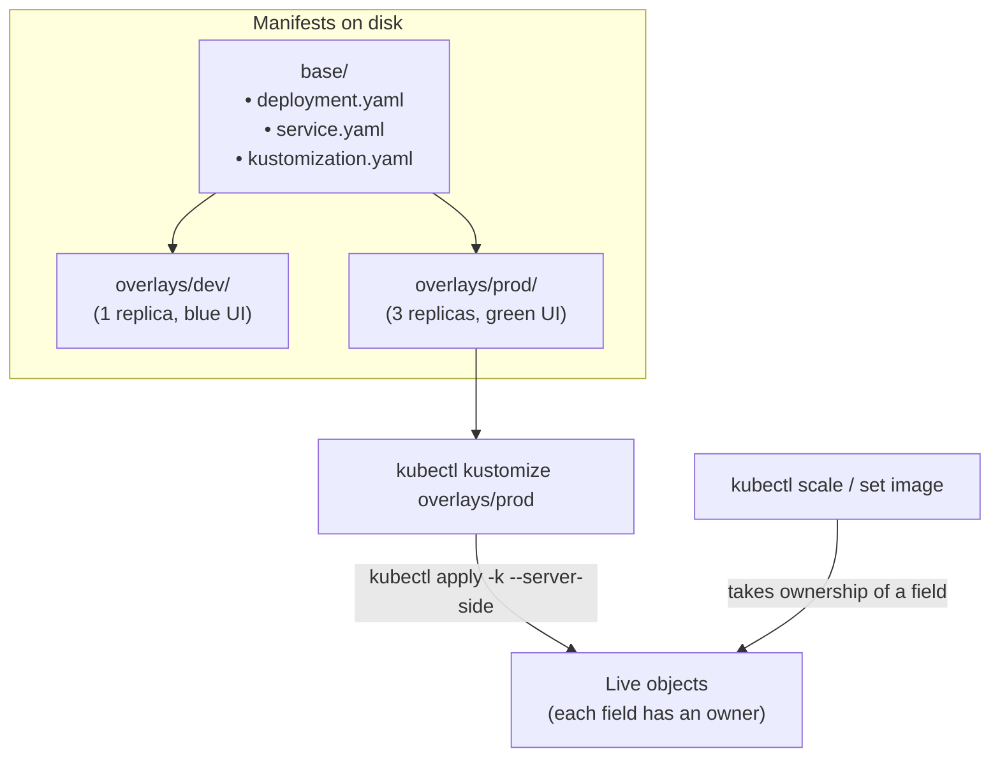

# Lab CKAD-07 — Kustomize, Drift & API Deprecations

In this lab you package `podinfo` with **Kustomize** (a `base` and two `overlays`), deploy two environments from it, change the live objects by hand and work through the **ownership conflict** that server-side apply reports, then migrate a manifest written for an API version the cluster no longer serves.

This lab uses its own namespaces and does not touch `default/podinfo`.

Concepts: [[Kubernetes/guides/delivery/templating-patching/kustomize|Kustomize]], [[Kubernetes/guides/non-functional/deprecations|Deprecations]] and [[Kubernetes/guides/non-functional/backup-restore|Backup and Restore]].

Tested 2026-10-13 on kind v0.33.0 with Kubernetes v1.37.0.



---

## 1. Prerequisites & Starting State

- Working `k8s-lab` cluster from **[[Kubernetes/labs/ckad/01-cluster-setup|Lab CKAD-01]]**. No other lab is required.
- A working directory:

```bash
mkdir -p /tmp/k8s-gitops/{base,overlays/dev,overlays/prod}
cd /tmp/k8s-gitops
```

---

## 2. A Base and Two Overlays

Kustomize does not use templates. A **base** holds plain manifests, and each **overlay** lists the changes one environment needs. It is built into `kubectl` (`kubectl kustomize`, `kubectl apply -k`).

### Step 1: The base

```bash
cat << 'EOF' > base/deployment.yaml
apiVersion: apps/v1
kind: Deployment
metadata:
  name: podinfo
spec:
  replicas: 1
  selector:
    matchLabels:
      app.kubernetes.io/name: podinfo
  template:
    metadata:
      labels:
        app.kubernetes.io/name: podinfo
    spec:
      containers:
        - name: podinfo
          image: ghcr.io/stefanprodan/podinfo:6.7.1
          ports:
            - name: http
              containerPort: 9898
          resources:
            requests:
              cpu: 50m
              memory: 32Mi
            limits:
              cpu: 200m
              memory: 128Mi
EOF

cat << 'EOF' > base/service.yaml
apiVersion: v1
kind: Service
metadata:
  name: podinfo
spec:
  type: ClusterIP
  selector:
    app.kubernetes.io/name: podinfo
  ports:
    - name: http
      port: 9898
      targetPort: http
EOF

cat << 'EOF' > base/kustomization.yaml
apiVersion: kustomize.config.k8s.io/v1beta1
kind: Kustomization
resources:
  - deployment.yaml
  - service.yaml
labels:
  - pairs:
      app.kubernetes.io/part-of: shop
EOF
```

`labels` adds the label to every object's metadata. The older `commonLabels` field is deprecated; it also rewrote selectors, which cannot be changed on an existing Deployment.

### Step 2: The overlays

Each overlay sets a namespace and name prefix, generates a ConfigMap, and patches the Deployment to read it. The production overlay also sets the replica count and pins the image tag.

```bash
cat << 'EOF' > overlays/dev/kustomization.yaml
apiVersion: kustomize.config.k8s.io/v1beta1
kind: Kustomization
resources:
  - ../../base
namespace: podinfo-dev
namePrefix: dev-
configMapGenerator:
  - name: ui
    literals:
      - PODINFO_UI_COLOR=#3498db
      - PODINFO_UI_MESSAGE=Development Environment
patches:
  - target:
      kind: Deployment
      name: podinfo
    patch: |-
      - op: add
        path: /spec/template/spec/containers/0/envFrom
        value:
          - configMapRef:
              name: ui
EOF

cat << 'EOF' > overlays/prod/kustomization.yaml
apiVersion: kustomize.config.k8s.io/v1beta1
kind: Kustomization
resources:
  - ../../base
namespace: podinfo-prod
namePrefix: prod-
replicas:
  - name: podinfo
    count: 3
images:
  - name: ghcr.io/stefanprodan/podinfo
    newTag: 6.7.1
configMapGenerator:
  - name: ui
    literals:
      - PODINFO_UI_COLOR=#2ecc71
      - PODINFO_UI_MESSAGE=Production Environment
patches:
  - target:
      kind: Deployment
      name: podinfo
    patch: |-
      - op: add
        path: /spec/template/spec/containers/0/envFrom
        value:
          - configMapRef:
              name: ui
EOF
```

---

## 3. Build, Inspect and Deploy

### Step 1: Render without applying

```bash
kubectl kustomize overlays/prod | grep -E "^kind:|  name:|namespace:|replicas:|part-of"
```

```
kind: ConfigMap
  name: prod-ui-68dhtt6gk2
  namespace: podinfo-prod
kind: Service
    app.kubernetes.io/part-of: shop
  name: prod-podinfo
  namespace: podinfo-prod
kind: Deployment
    app.kubernetes.io/part-of: shop
  name: prod-podinfo
  namespace: podinfo-prod
  replicas: 3
            name: prod-ui-68dhtt6gk2
        name: podinfo
          name: http
```

Three things to notice:

- names carry the prefix and every object has the namespace;
- the generated ConfigMap name ends in a **hash of its content**, and the reference inside the Deployment was rewritten to match. Change a literal and the name changes, which changes the Pod template and so triggers a rollout;
- the patch wrote `name: ui`, and Kustomize resolved it.

### Step 2: Deploy both environments

```bash
kubectl create namespace podinfo-dev
kubectl create namespace podinfo-prod

kubectl apply -k overlays/dev --server-side
kubectl apply -k overlays/prod --server-side
kubectl rollout status deployment/prod-podinfo -n podinfo-prod --timeout=120s

kubectl get deployment -n podinfo-dev
kubectl get deployment -n podinfo-prod
kubectl exec -n podinfo-prod deployment/prod-podinfo -- env | grep PODINFO_UI_
```

```
NAME          READY   UP-TO-DATE   AVAILABLE   AGE
dev-podinfo   1/1     1            1           2s

NAME           READY   UP-TO-DATE   AVAILABLE   AGE
prod-podinfo   3/3     3            3           2s

PODINFO_UI_COLOR=#2ecc71
PODINFO_UI_MESSAGE=Production Environment
```

---

## 4. Controlled Scenario: Drift and Field Ownership

With **server-side apply**, the API server records which manager set each field. That record decides what happens when two sources disagree.

### Step 1: Change the live object by hand

```bash
kubectl scale deployment/prod-podinfo -n podinfo-prod --replicas=1
kubectl set image deployment/prod-podinfo -n podinfo-prod podinfo=ghcr.io/stefanprodan/podinfo:6.7.0
```

The cluster now differs from the files. See who owns what:

```bash
kubectl get deployment prod-podinfo -n podinfo-prod \
  -o jsonpath='{range .metadata.managedFields[*]}{.manager}{" ("}{.operation}{") "}{.subresource}{"\n"}{end}'
```

```
kubectl (Apply)
kubectl (Update) scale
kube-controller-manager (Update) status
kubectl-set (Update)
```

`kubectl scale` and `kubectl set image` each became the owner of the field they changed.

### Step 2: Apply the files again and read the conflict

```bash
kubectl apply -k overlays/prod --server-side
```

```
configmap/prod-ui-68dhtt6gk2 serverside-applied
service/prod-podinfo serverside-applied
error: Apply failed with 2 conflicts: conflicts with "kubectl" with subresource "scale" using apps/v1:
- .spec.replicas
conflicts with "kubectl-set" using apps/v1:
- .spec.template.spec.containers[name="podinfo"].image
Please review the fields above--they currently have other managers. Here
are the ways you can resolve this warning:
* If you intend to manage all of these fields, please re-run the apply
  command with the `--force-conflicts` flag.
* If you do not intend to manage all of the fields, please edit your
  manifest to remove references to the fields that should keep their
  current managers.
* You may co-own fields by updating your manifest to match the existing
  value; in this case, you'll become the manager if the other manager(s)
  stop managing the field (remove it from their configuration).
```

The apply is **refused**, and the Deployment is unchanged. Server-side apply will not silently overwrite a field another manager set. The message lists the three choices, and they are a decision, not a formality:

| Choice                                | When it is right                                                                                                |
| :------------------------------------ | :-------------------------------------------------------------------------------------------------------------- |
| `--force-conflicts`                   | The files are the source of truth and the manual change was a mistake                                           |
| Remove the field from the manifest    | Something else should own it. The usual case is `replicas` when a HorizontalPodAutoscaler scales the Deployment |
| Change the manifest to the live value | The manual change was correct and the files are behind                                                          |

### Step 3: Resolve it

Here the files are the source of truth:

```bash
kubectl apply -k overlays/prod --server-side --force-conflicts

kubectl get deployment prod-podinfo -n podinfo-prod \
  -o jsonpath='{.spec.replicas} {.spec.template.spec.containers[0].image}{"\n"}'
```

```
deployment.apps/prod-podinfo serverside-applied
3 ghcr.io/stefanprodan/podinfo:6.7.1
```

> [!note] Client-side apply behaves differently
> Without `--server-side`, `kubectl apply -k` would have overwritten both fields with no conflict, because both are in the file. It would **not** remove a field added by hand that the file does not mention; [[Kubernetes/labs/ckad/04-configuration|Lab CKAD-04]] shows that case. Preview either kind of apply with `kubectl diff -k overlays/prod`.

Running `kubectl apply` by hand is one reconciliation. A GitOps controller such as Argo CD or Flux does the same thing on a loop; nothing in this lab installs one.

---

## 5. Migrating a Manifest From a Removed API Version

A manifest keeps working only while the cluster serves its `apiVersion`. Create one written for an old cluster:

```bash
cat << 'EOF' > old-ingress.yaml
apiVersion: networking.k8s.io/v1beta1
kind: Ingress
metadata:
  name: shop
  namespace: podinfo-dev
spec:
  rules:
    - host: shop.example.test
      http:
        paths:
          - path: /
            backend:
              serviceName: dev-podinfo
              servicePort: 9898
EOF

kubectl apply -f old-ingress.yaml
```

```
error: resource mapping not found for name: "shop" namespace: "podinfo-dev" from "old-ingress.yaml": no matches for kind "Ingress" in version "networking.k8s.io/v1beta1"
ensure CRDs are installed first
```

`no matches for kind ... in version ...` means the kind exists but not at that version. Find the version the cluster serves and what its schema requires:

```bash
kubectl api-resources --api-group=networking.k8s.io
kubectl explain ingress.spec.rules.http.paths --api-version=networking.k8s.io/v1
```

```
NAME              SHORTNAMES   APIVERSION             NAMESPACED   KIND
ingressclasses                 networking.k8s.io/v1   false        IngressClass
ingresses         ing          networking.k8s.io/v1   true         Ingress
ipaddresses       ip           networking.k8s.io/v1   false        IPAddress
networkpolicies   netpol       networking.k8s.io/v1   true         NetworkPolicy
servicecidrs                   networking.k8s.io/v1   false        ServiceCIDR
```

`kubectl explain` shows that in `v1` both `backend` and `pathType` are required, and `backend` is now a `service` object with a `name` and a `port`. Changing only the `apiVersion` line is not enough. Write the migrated file and validate it against the API server without creating anything:

```bash
cat << 'EOF' > new-ingress.yaml
apiVersion: networking.k8s.io/v1
kind: Ingress
metadata:
  name: shop
  namespace: podinfo-dev
spec:
  rules:
    - host: shop.example.test
      http:
        paths:
          - path: /
            pathType: Prefix
            backend:
              service:
                name: dev-podinfo
                port:
                  number: 9898
EOF

kubectl apply --dry-run=server -f new-ingress.yaml
```

```
ingress.networking.k8s.io/shop created (server dry run)
```

Two related checks:

- **Gateway API is a different API group**, `gateway.networking.k8s.io`, and is served only after its CRDs are installed. It does not appear in the listing above, and its absence there says nothing about deprecation.
- Before an upgrade, the API server reports which deprecated versions clients are still calling:

  ```bash
  kubectl get --raw /metrics | grep '^apiserver_requested_deprecated_apis'
  ```

  The [deprecated API migration guide](https://kubernetes.io/docs/reference/using-api/deprecation-guide/) lists what each release removes.

---

## 6. Recreating a Namespace From Its Manifests

Delete the production namespace and rebuild it from the overlay:

```bash
kubectl delete namespace podinfo-prod

kubectl create namespace podinfo-prod
kubectl apply -k overlays/prod --server-side
kubectl rollout status deployment/prod-podinfo -n podinfo-prod --timeout=120s
kubectl exec -n podinfo-prod deployment/prod-podinfo -- env | grep PODINFO_UI_MESSAGE
```

```
PODINFO_UI_MESSAGE=Production Environment
```

Everything came back, including the configuration, because all of it is in the files. Be precise about what this proves: it redeploys **declared objects**. It does not restore anything created at runtime, such as a Secret added with `kubectl create`, the contents of a PersistentVolume, or a database. Those need a real backup, which is the subject of [[Kubernetes/guides/non-functional/backup-restore|Backup and Restore]] and [[Kubernetes/labs/cka/05-etcd-backup-restore|Lab CKA-05]].

---

## 7. Cleanup

```bash
kubectl delete namespace podinfo-dev podinfo-prod
cd ~ && rm -rf /tmp/k8s-gitops
```

---

## Practice Without the Answer

Start again from the base and overlays above (re-create them if you cleaned up). Suggested time: 10 minutes.

1. Add an overlay `overlays/staging` that deploys to namespace `podinfo-staging` with prefix `stg-`, two replicas, the UI message `Staging Environment`, and an extra label `tier: staging` on every object.
2. Without editing the base, make staging use image tag `6.7.0`.
3. Render it and save the output to `/tmp/staging.yaml`.

Check yourself:

```bash
grep -c "tier: staging" /tmp/staging.yaml          # 3 or more
grep "image:" /tmp/staging.yaml                    # ...podinfo:6.7.0
grep -E "replicas:|namespace:" /tmp/staging.yaml   # replicas: 2, namespace: podinfo-staging
kubectl apply --dry-run=server -f /tmp/staging.yaml   # after creating the namespace
```

---

## Further reading

- [Declarative management with Kustomize](https://kubernetes.io/docs/tasks/manage-kubernetes-objects/kustomization/)
- [Deprecated API migration guide](https://kubernetes.io/docs/reference/using-api/deprecation-guide/)
- [Server-side apply: conflicts](https://kubernetes.io/docs/reference/using-api/server-side-apply/#conflicts)

## Next Lab

Proceed to **[[Kubernetes/labs/ckad/08-build-and-ship-images|Lab CKAD-08 — Build & Ship Container Images]]**, or return to the [[Kubernetes/certifications/ckad|CKAD Track]].
