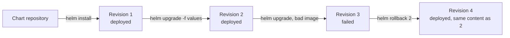

# Lab CKAD-11 — Helm Release Lifecycle

Both the CKAD and CKA objectives ask you to use Helm to deploy existing packages. Installing a chart once, as the other labs do for Traefik or Falco, is not the same skill as managing a **release**: discovering what a chart lets you set, upgrading it, reading its history and undoing a bad change. This lab does the whole cycle with the `podinfo` chart.

Concepts: [[Kubernetes/guides/delivery/templating-patching/helm/README|Helm]], [[Kubernetes/guides/delivery/templating-patching/helm/commands|Helm Commands]] and [[Kubernetes/guides/delivery/templating-patching/helm/troubleshooting|Helm Troubleshooting]].

Tested 2026-10-13 on kind v0.33.0 with Kubernetes v1.37.0 and Helm v4.2.2. The commands are the same on Helm 3.



---

## 1. Prerequisites & Starting State

- Working `k8s-lab` cluster from **[[Kubernetes/labs/ckad/01-cluster-setup|Lab CKAD-01]]** and `helm` on your machine. No other lab is required.

```bash
kubectl create namespace helm-lab
```

Three words to keep apart: a **chart** is the package, a **release** is one installation of it with a name, and a **revision** is one version of that release. Helm stores each revision as a Secret in the release's namespace.

---

## 2. Find the Chart and What It Lets You Set

```bash
helm repo add podinfo https://stefanprodan.github.io/podinfo
helm repo update podinfo

helm search repo podinfo/podinfo --versions | head -n 4
```

```
NAME           	CHART VERSION	APP VERSION	DESCRIPTION
podinfo/podinfo	6.15.0       	6.15.0     	Podinfo Helm chart for Kubernetes
podinfo/podinfo	6.14.1       	6.14.1     	Podinfo Helm chart for Kubernetes
podinfo/podinfo	6.14.0       	6.14.0     	Podinfo Helm chart for Kubernetes
```

`CHART VERSION` is the version of the package and `APP VERSION` is the application it installs by default. They are separate numbers that happen to match in this chart. Always pass `--version`; without it Helm installs the newest chart, and the same command gives a different result next month.

A chart's settings are its **values**. Read them before installing:

```bash
helm show values podinfo/podinfo --version 6.7.0 | grep -nE "^replicaCount|^ui:|  message|  color|^image:|  tag:|^service:|^resources:"
```

```
3:replicaCount: 1
9:image:
11:  tag: 6.7.0
14:ui:
15:  color: "#34577c"
16:  message: ""
29:service:
141:resources:
```

Nested keys are written with dots on the command line: `ui.message`, `image.tag`.

---

## 3. Install

```bash
helm install shop podinfo/podinfo --version 6.7.0 -n helm-lab \
  --set replicaCount=2 \
  --set ui.message="installed by helm"

kubectl -n helm-lab rollout status deployment/shop-podinfo --timeout=120s
helm list -n helm-lab
helm get values shop -n helm-lab
```

```
NAME	NAMESPACE	REVISION	UPDATED                 	STATUS  	CHART        	APP VERSION
shop	helm-lab 	1       	2026-10-13 16:40:35 ...	deployed	podinfo-6.7.0	6.7.0

USER-SUPPLIED VALUES:
replicaCount: 2
ui:
  message: installed by helm
```

- `helm list` is per namespace. Add `-n <namespace>` or `-A`, or a release in another namespace looks as if it does not exist.
- `helm get values` shows only what **you** supplied. Add `--all` to see the result merged with the chart's defaults.
- The objects are named after the release: `shop-podinfo`. To see what a release created, use `helm get manifest shop -n helm-lab`.

To see what a chart would create without installing anything, render it locally:

```bash
helm template shop podinfo/podinfo --version 6.7.0 --set replicaCount=2 | grep '^kind:'
```

---

## 4. Upgrade With a Values File

Several settings are easier to keep in a file than in a row of `--set` flags:

```bash
cat << 'EOF' > values-prod.yaml
replicaCount: 3
ui:
  message: "upgraded with a values file"
  color: "#2ecc71"
resources:
  requests:
    cpu: 50m
    memory: 32Mi
EOF

helm upgrade shop podinfo/podinfo --version 6.7.1 -n helm-lab -f values-prod.yaml
kubectl -n helm-lab rollout status deployment/shop-podinfo --timeout=120s

helm history shop -n helm-lab
kubectl -n helm-lab get deployment shop-podinfo \
  -o jsonpath='{.spec.replicas} {.spec.template.spec.containers[0].image}{"\n"}'
```

```
REVISION	UPDATED                 	STATUS    	CHART        	APP VERSION	DESCRIPTION
1       	Tue Oct 13 16:40:35 2026	superseded	podinfo-6.7.0	6.7.0      	Install complete
2       	Tue Oct 13 16:40:48 2026	deployed  	podinfo-6.7.1	6.7.1      	Upgrade complete

3 ghcr.io/stefanprodan/podinfo:6.7.1
```

This one upgrade changed the chart version and the values together.

> [!warning] An upgrade replaces the values unless you say otherwise
> `helm upgrade` uses the chart's defaults plus the values given **in that command**. The `ui.message` set at install time survived here only because the file sets it again. To keep the previous values and change one more, add `--reuse-values`. `-f` and `--set` can be combined; the rightmost wins.

---

## 5. Controlled Failure Scenario: An Upgrade That Does Not Come Up

Upgrade to an image tag that does not exist, and tell Helm to wait for the workload:

```bash
helm upgrade shop podinfo/podinfo --version 6.7.1 -n helm-lab \
  --reuse-values --set image.tag=9.9.9-missing --wait --timeout 40s
```

```
Error: UPGRADE FAILED: resource Deployment/helm-lab/shop-podinfo not ready. status: InProgress, message: Updated: 2/3
context deadline exceeded
```

```bash
helm history shop -n helm-lab
kubectl -n helm-lab get pods
```

```
REVISION	UPDATED                 	STATUS    	CHART        	APP VERSION	DESCRIPTION
1       	Tue Oct 13 16:40:35 2026	superseded	podinfo-6.7.0	6.7.0      	Install complete
2       	Tue Oct 13 16:40:48 2026	deployed  	podinfo-6.7.1	6.7.1      	Upgrade complete
3       	Tue Oct 13 16:41:12 2026	failed    	podinfo-6.7.1	6.7.1      	Upgrade "shop" failed: resource Deployment/helm-lab/shop-podinfo not ready ...

NAME                            READY   STATUS         RESTARTS   AGE
shop-podinfo-595cc44f7-jczms    0/1     ErrImagePull   0          40s
shop-podinfo-595cc44f7-t7sgb    0/1     ErrImagePull   0          40s
shop-podinfo-768b8f67d7-4zl66   1/1     Running        0          64s
shop-podinfo-768b8f67d7-pxwvr   1/1     Running        0          64s
```

Two layers are involved and each tells half the story:

- **Helm** knows the upgrade failed only because of `--wait`. Without it, Helm reports success as soon as the API server accepts the objects, and revision 3 would say `deployed` while the Pods fail.
- **Kubernetes** shows why: `ErrImagePull`. Helm does not diagnose workloads; use `kubectl describe pod` as in [[Kubernetes/labs/ckad/03-updates-and-rollbacks|Lab CKAD-03]].

A failed upgrade is **not** undone automatically. The bad Deployment is still in the cluster, kept partly alive by the Deployment's own rolling update. (`--rollback-on-failure`, called `--atomic` in Helm 3, makes Helm roll back for you.)

### Roll back

```bash
helm rollback shop 2 -n helm-lab --wait --timeout 90s

helm history shop -n helm-lab | tail -n 2
kubectl -n helm-lab get deployment shop-podinfo \
  -o jsonpath='{.spec.replicas} {.spec.template.spec.containers[0].image}{"\n"}'
```

```
Rollback was a success! Happy Helming!
3       	Tue Oct 13 16:41:12 2026	failed    	podinfo-6.7.1	6.7.1      	Upgrade "shop" failed ...
4       	Tue Oct 13 16:41:53 2026	deployed  	podinfo-6.7.1	6.7.1      	Rollback to 2

3 ghcr.io/stefanprodan/podinfo:6.7.1
```

A rollback creates a **new** revision (4) with the content of the one you named. History is never rewritten. `helm rollback shop` without a number goes back one revision, which here would have been the failed one's predecessor as well; name the revision when it matters.

---

## 6. Uninstall

```bash
helm uninstall shop -n helm-lab
helm list -n helm-lab --all
kubectl delete namespace helm-lab
rm -f values-prod.yaml
```

`uninstall` removes every object the release created and its history. It does not remove the namespace, PersistentVolumeClaims created from a StatefulSet's templates, or CRDs a chart installed.

---

## Command Summary

| Task                                  | Command                                                   |
| :------------------------------------ | :-------------------------------------------------------- |
| Find a chart and its versions         | `helm search repo <name> --versions`                      |
| See what can be set                   | `helm show values <chart> --version <v>`                  |
| Render without installing             | `helm template <release> <chart> -f values.yaml`          |
| Install                               | `helm install <release> <chart> --version <v> -n <ns>`    |
| List releases                         | `helm list -n <ns>` or `helm list -A`                     |
| Values in use                         | `helm get values <release> -n <ns> [--all]`               |
| Objects in the release                | `helm get manifest <release> -n <ns>`                     |
| Upgrade                               | `helm upgrade <release> <chart> -f values.yaml`           |
| Install or upgrade, whichever applies | `helm upgrade --install ...`                              |
| History and rollback                  | `helm history <release>`, `helm rollback <release> <rev>` |
| Remove                                | `helm uninstall <release> -n <ns>`                        |

---

## Practice Without the Answer

Suggested time: 10 minutes. Namespace `web`.

1. Install chart `podinfo/podinfo` version `6.7.1` as release `front` with 2 replicas and the Service type `NodePort`.
2. Upgrade the release so that it has 3 replicas and the UI message `v2`, without losing the Service type.
3. Write the release's user-supplied values to `/tmp/front-values.yaml`.
4. Roll back to revision 1.

Check yourself:

```bash
helm history front -n web                      # 3 revisions; the last says "Rollback to 1"
kubectl -n web get service front-podinfo -o jsonpath='{.spec.type}{"\n"}'          # NodePort
kubectl -n web get deployment front-podinfo -o jsonpath='{.spec.replicas}{"\n"}'   # 2
grep -c . /tmp/front-values.yaml               # written while revision 2 was current: replicaCount 3, ui.message v2, service.type NodePort
```

Reset with `helm uninstall front -n web; kubectl delete namespace web`.

---

## Further reading

- [Helm: using Helm](https://helm.sh/docs/intro/using_helm/)
- [helm upgrade](https://helm.sh/docs/helm/helm_upgrade/) and [helm rollback](https://helm.sh/docs/helm/helm_rollback/)

## Next Lab

Proceed to **[[Kubernetes/labs/ckad/12-blue-green-and-canary|Lab CKAD-12 — Blue/Green & Canary Deployments]]**, or return to the [[Kubernetes/certifications/ckad|CKAD Track]].
