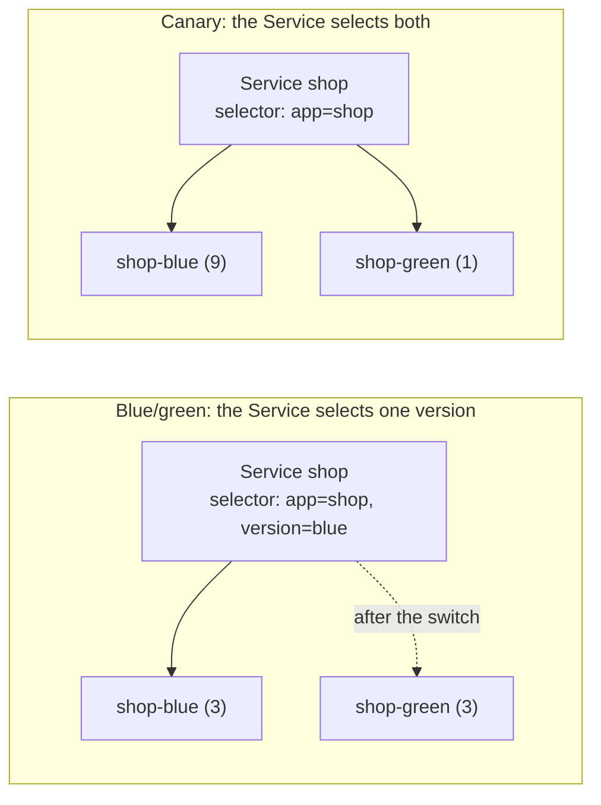

# Lab CKAD-12 — Blue/Green & Canary Deployments

The CKAD objective "use Kubernetes primitives to implement common deployment strategies (e.g. blue/green or canary)" does not mean a service mesh or Argo Rollouts. It means two Deployments, one Service, and the labels that connect them. A rolling update, which [[Kubernetes/labs/ckad/03-updates-and-rollbacks|Lab CKAD-03]] covers, is a third strategy and is built into the Deployment.

Concepts: [[Kubernetes/guides/delivery/progressive-delivery/strategies|Progressive Delivery Strategies]], [[Kubernetes/concepts/L04-services-networking/02-services|Services]] and [[Kubernetes/concepts/L03-workloads/03-deployments|Deployments]].

Tested 2026-10-13 on kind v0.33.0 with Kubernetes v1.37.0.



| Strategy   | How traffic moves                                   | Rollback                   | Cost                                      |
| :--------- | :-------------------------------------------------- | :------------------------- | :---------------------------------------- |
| Rolling    | Pods are replaced a few at a time                   | `kubectl rollout undo`     | No extra capacity beyond `maxSurge`       |
| Blue/green | All at once, by changing the Service selector       | Change the selector back   | Two full copies run during the release    |
| Canary     | A share proportional to the new version's Pod count | Scale the new version to 0 | Coarse percentages, set by replica counts |

---

## 1. Prerequisites & Starting State

- Working `k8s-lab` cluster from **[[Kubernetes/labs/ckad/01-cluster-setup|Lab CKAD-01]]**. No other lab is required.

```bash
kubectl create namespace release-lab
kubectl config set-context --current --namespace=release-lab
```

---

## 2. Two Versions Side by Side

Both Deployments run the same image. An environment variable makes each one say which version it is, so that responses can be counted.

```bash
for V in blue green; do
cat << EOF | kubectl apply -f -
apiVersion: apps/v1
kind: Deployment
metadata:
  name: shop-$V
spec:
  replicas: 3
  selector:
    matchLabels:
      app: shop
      version: $V
  template:
    metadata:
      labels:
        app: shop
        version: $V
    spec:
      containers:
        - name: podinfo
          image: ghcr.io/stefanprodan/podinfo:6.7.1
          env:
            - name: PODINFO_UI_MESSAGE
              value: $V
          readinessProbe:
            httpGet:
              path: /readyz
              port: 9898
EOF
done

kubectl rollout status deployment/shop-blue --timeout=120s
kubectl rollout status deployment/shop-green --timeout=120s
```

The labels carry the design:

- every Pod has `app=shop`, which is what the two versions have in common;
- every Pod has `version=blue` or `version=green`, which is what tells them apart;
- each Deployment's **selector includes `version`**. If both selected only `app=shop`, each would count the other's Pods as its own.

A client Pod and a helper to count which version answers:

```bash
kubectl run client --image=curlimages/curl:8.10.1 --restart=Never --command -- sleep 3600
kubectl wait --for=condition=Ready pod/client --timeout=90s

count() {
  kubectl exec client -- sh -c "for i in \$(seq 1 $1); do curl -s http://shop/api/info | grep -o '\"message\": \"[a-z]*\"'; done" | sort | uniq -c
}
```

---

## 3. Blue/Green

Create the Service so that it selects **blue only**:

```bash
kubectl create service clusterip shop --tcp=80:9898 --dry-run=client -o yaml \
  | kubectl set selector --local -f - 'app=shop,version=blue' -o yaml \
  | kubectl apply -f -

kubectl get endpointslices -l kubernetes.io/service-name=shop
count 10
```

```
NAME         ADDRESSTYPE   PORTS   ENDPOINTS                             AGE
shop-n4dv9   IPv4          9898    10.244.2.31,10.244.1.45,10.244.2.32   2s

     10 "message": "blue"
```

Three endpoints, all blue. Green is running and ready but receives nothing, which is the point: you can test it directly (for example with `kubectl port-forward deployment/shop-green 9898`) before any user reaches it.

### Switch

```bash
kubectl set selector service shop 'app=shop,version=green'
count 10
```

```
service/shop selector updated
     10 "message": "green"
```

One field changed and all new connections go to green. Nothing was restarted.

### Roll back

```bash
kubectl set selector service shop 'app=shop,version=blue'
count 5
```

```
     5 "message": "blue"
```

Rollback is the same operation in reverse, and it is fast because blue never stopped. Once you are satisfied with green, scale blue to zero or delete it.

> [!note] What the switch does not do
> Connections that are already open stay with the Pod they reached, so the cut-over is immediate only for new connections. And a selector typo sends traffic nowhere: check `kubectl get endpointslices` after every switch.

---

## 4. Canary

Now make the Service select **both** versions and control the split with replica counts:

```bash
kubectl set selector service shop 'app=shop'
kubectl scale deployment shop-blue --replicas=9
kubectl scale deployment shop-green --replicas=1
kubectl rollout status deployment/shop-blue --timeout=120s

count 100
```

```
     89 "message": "blue"
     11 "message": "green"
```

Ten Pods are behind the Service and one of them is green, so about one request in ten reaches it. The Service spreads connections evenly over its ready endpoints and knows nothing about versions.

Increase the share by changing the ratio:

```bash
kubectl scale deployment shop-green --replicas=5
kubectl scale deployment shop-blue --replicas=5
kubectl rollout status deployment/shop-green --timeout=120s

count 100
```

```
     59 "message": "blue"
     41 "message": "green"
```

Roughly half. The split is statistical, not exact: backends are chosen at random per connection, so 100 requests rarely divide precisely. To finish the release, scale green to the full count and blue to zero. To abort it, scale green to zero.

What this method cannot do: route by header or user, hold an exact percentage, or send 1% without running 100 Pods. Those need an ingress controller, Gateway API traffic weights or a service mesh, which are beyond what the CKAD asks for.

---

## 5. Controlled Failure Scenario: A Selector That Catches Too Much

Start a third Deployment for an unrelated internal tool, and give it a careless label:

```bash
kubectl create deployment admin-tool --image=busybox:1.36 -- sleep 3600
kubectl label pods -l app=admin-tool app=shop --overwrite

kubectl get endpointslices -l kubernetes.io/service-name=shop -o yaml | grep -c "ready: true"
kubectl get pods -l app=shop -L version
```

The Service's selector is still `app=shop`, so it now includes a Pod that does not serve HTTP on port 9898, and a share of requests fail with a connection error. The ReplicaSet of `admin-tool` also notices its Pod no longer matches and starts a replacement, exactly as in [[Kubernetes/labs/ckad/02-deploy-workload|Lab CKAD-02]].

The symptom is intermittent failures; the cause is a selector that is broader than the set of Pods you mean. Diagnose with `kubectl get pods -l <the Service's selector>` and look for anything that does not belong.

```bash
kubectl delete deployment admin-tool
kubectl delete pods -l app=shop,version!=blue,version!=green
```

---

## 6. Cleanup

```bash
kubectl config set-context --current --namespace=default
kubectl delete namespace release-lab
```

---

## Practice Without the Answer

Suggested time: 10 minutes. Namespace `rollout`.

A Deployment `api-v1` (image `ghcr.io/stefanprodan/podinfo:6.7.0`, 4 replicas, labels `app=api,track=stable`) and a Service `api` (port 80 to 9898, selecting `app=api,track=stable`) exist. Create them first, then:

1. Deploy `api-v2` with image `ghcr.io/stefanprodan/podinfo:6.7.1` so that about 20% of requests to `api` reach it. Do not change the total number of Pods serving the Service.
2. Then complete the release as a blue/green switch: all traffic to v2, with v1 still running and receiving none.

Check yourself:

```bash
# after step 1: 5 endpoints, 1 of them v2
kubectl -n rollout get pods -l app=api -L track --no-headers | awk '{print $NF}' | sort | uniq -c
kubectl -n rollout get endpointslices -l kubernetes.io/service-name=api
# after step 2: the selector names only v2's label, and v1 still has ready replicas
kubectl -n rollout get service api -o jsonpath='{.spec.selector}{"\n"}'
kubectl -n rollout get deployment api-v1 -o jsonpath='{.status.readyReplicas}{"\n"}'
```

Reset with `kubectl delete namespace rollout`.

---

## Further reading

- [Deployments: canary pattern](https://kubernetes.io/docs/concepts/workloads/management/#canary-deployments)
- [Labels and selectors](https://kubernetes.io/docs/concepts/overview/working-with-objects/labels/)

## Next Lab

Proceed to **[[Kubernetes/labs/ckad/13-quotas-limit-ranges-and-probes|Lab CKAD-13 — Quotas, LimitRanges & Probes]]**, or return to the [[Kubernetes/certifications/ckad|CKAD Track]].
