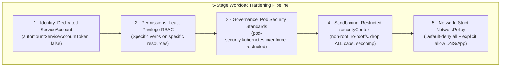

# Lab CKS-01 — Workload Security Hardening

In this lab you audit a workload that was deployed with no security settings, record what it can actually do, and harden **the same Deployment** layer by layer: identity, RBAC, Pod Security Standards, `securityContext` and NetworkPolicy. Every layer ends with a test of what must still work and what must now fail.

Concepts: [[Kubernetes/concepts/L07-security/01-api-access/03-rbac|RBAC]], [[Kubernetes/concepts/L07-security/01-api-access/02-service-accounts|Service Accounts]], [[Kubernetes/concepts/L07-security/02-workload-sandboxing/06-pod-security-standards|Pod Security Standards]], [[Kubernetes/concepts/L07-security/02-workload-sandboxing/05-security-context|SecurityContext]] and [[Kubernetes/concepts/L04-services-networking/05-network-policy|NetworkPolicy]].

Tested 2026-10-13 on kind v0.33.0 with Kubernetes v1.37.0.



---

## 1. Prerequisites & Starting State

- Working `k8s-lab` cluster from **[[Kubernetes/labs/ckad/01-cluster-setup|Lab CKAD-01]]**, including the `default/podinfo` Service from the CKAD labs if you want the cross-namespace test in section 7 to have a target. Any Service in another namespace will do.
- The cluster's CNI must enforce NetworkPolicy. The kind node image used in these labs does. Section 7 proves it with a before-and-after test instead of assuming it.

---

## 2. The Baseline Workload

The workload has three typical weaknesses: no security settings, the namespace's `default` ServiceAccount, and a broad RoleBinding someone added "to make it work".

```bash
kubectl create namespace sec-lab

cat << 'EOF' > baseline.yaml
apiVersion: apps/v1
kind: Deployment
metadata:
  name: podinfo
  namespace: sec-lab
spec:
  replicas: 2
  selector:
    matchLabels:
      app: podinfo
  template:
    metadata:
      labels:
        app: podinfo
    spec:
      containers:
        - name: podinfo
          image: ghcr.io/stefanprodan/podinfo:6.7.1
          ports:
            - name: http
              containerPort: 9898
---
apiVersion: v1
kind: Service
metadata:
  name: podinfo
  namespace: sec-lab
spec:
  selector:
    app: podinfo
  ports:
    - port: 9898
      targetPort: http
---
apiVersion: rbac.authorization.k8s.io/v1
kind: RoleBinding
metadata:
  name: legacy-app-access
  namespace: sec-lab
roleRef:
  apiGroup: rbac.authorization.k8s.io
  kind: ClusterRole
  name: edit
subjects:
  - kind: ServiceAccount
    name: default
    namespace: sec-lab
EOF

kubectl apply -f baseline.yaml
kubectl -n sec-lab rollout status deployment/podinfo --timeout=120s
kubectl -n sec-lab create secret generic db-credentials --from-literal=password=s3cr3t
```

---

## 3. Inventory: What Can It Really Do?

Measure before changing anything. Assumptions about a default workload are often wrong.

```bash
kubectl -n sec-lab exec deployment/podinfo -- id
kubectl -n sec-lab exec deployment/podinfo -- sh -c 'grep -E "CapEff|CapBnd|NoNewPrivs|Seccomp:" /proc/1/status'
kubectl -n sec-lab exec deployment/podinfo -- sh -c 'ls /var/run/secrets/kubernetes.io/serviceaccount/'
kubectl -n sec-lab exec deployment/podinfo -- sh -c 'touch /home/app/x && echo "root filesystem is writable"'
```

```
uid=100(app) gid=101(app) groups=101(app)
CapEff:	0000000000000000
CapBnd:	00000000a80425fb
NoNewPrivs:	0
Seccomp:	0
ca.crt
namespace
token
root filesystem is writable
```

| Finding                                            | Evidence                           | What it means                                                                                                                                                                            |
| :------------------------------------------------- | :--------------------------------- | :--------------------------------------------------------------------------------------------------------------------------------------------------------------------------------------- |
| Not root                                           | `uid=100(app)`                     | The image's Dockerfile sets `USER`. No `securityContext` does **not** mean root; it means "whatever the image says". Nothing in the Pod spec prevents a later image from running as root |
| No effective capabilities, but a full bounding set | `CapEff` zero, `CapBnd` `a80425fb` | A non-root process starts with none in effect. The bounding set is the runtime's default list, which a setuid binary could regain                                                        |
| Privilege escalation possible                      | `NoNewPrivs: 0`                    | setuid binaries can raise privileges                                                                                                                                                     |
| No seccomp filter                                  | `Seccomp: 0`                       | Every system call is allowed. On this cluster a Pod with no `seccompProfile` is unconfined; that depends on the kubelet's `seccompDefault` setting                                       |
| API token mounted                                  | `token`                            | The process can authenticate to the API server                                                                                                                                           |
| Writable root filesystem                           | `touch` succeeded                  | An attacker can drop tools or change files                                                                                                                                               |

Now find out what the token is worth and where the Pod can connect:

```bash
kubectl -n sec-lab exec deployment/podinfo -- sh -c '
  T=$(cat /var/run/secrets/kubernetes.io/serviceaccount/token)
  curl -sk -H "Authorization: Bearer $T" \
    https://kubernetes.default.svc/api/v1/namespaces/sec-lab/secrets/db-credentials | grep "\"password\""'

kubectl auth can-i --list -n sec-lab --as=system:serviceaccount:sec-lab:default | head -n 6

kubectl -n sec-lab exec deployment/podinfo -- sh -c '
  curl -s -m 5 -o /dev/null -w "other namespace: %{http_code}\n" http://podinfo.default.svc:9898/
  curl -s -m 5 -o /dev/null -w "internet: %{http_code}\n" https://kubernetes.io'
```

```
    "password": "czNjcjN0"

Resources                    Non-Resource URLs   Resource Names   Verbs
leases.coordination.k8s.io   []                  []               [create delete deletecollection get list patch update watch]
configmaps                   []                  []               [create delete deletecollection patch update get list watch]
events                       []                  []               [create delete deletecollection patch update get list watch]
persistentvolumeclaims       []                  []               [create delete deletecollection patch update get list watch]

other namespace: 200
internet: 200
```

The application read a Secret through the API with its own token, can change most objects in its namespace, and can reach other namespaces and the internet. Those are the serious findings, and none of them is "runs as root".

`kubectl auth can-i --list` is the tool for auditing an identity. A single `can-i` that answers `no` proves only that one verb on one resource is denied.

---

## 4. Layer 1: Identity and RBAC

`podinfo` never calls the Kubernetes API, so it needs no permissions and no token.

```bash
kubectl -n sec-lab create serviceaccount podinfo-sa
kubectl -n sec-lab patch serviceaccount podinfo-sa -p '{"automountServiceAccountToken":false}'

kubectl -n sec-lab delete rolebinding legacy-app-access
```

Verify the binding is gone and the new identity has nothing beyond what every authenticated identity gets:

```bash
kubectl auth can-i get secrets -n sec-lab --as=system:serviceaccount:sec-lab:default
kubectl auth can-i --list -n sec-lab --as=system:serviceaccount:sec-lab:podinfo-sa
```

```
no
```

The list for `podinfo-sa` contains only self-review entries, a few non-resource URLs such as `/healthz` and `/version`, and read access to cluster trust bundles. Those come from built-in roles bound to all authenticated users; there is no namespaced resource in it.

Removing the binding takes effect at once, even for the running Pods. The Pods still use the `default` ServiceAccount and still have a token mounted, because a Pod's ServiceAccount cannot be changed after creation. That is fixed in layer 3.

> [!note] When a workload does need the API
> Create a Role with the exact verbs and resources (and `resourceNames` where possible), bind it to a dedicated ServiceAccount, and test both a request that must succeed and one that must fail. [[Kubernetes/labs/cks/13-rbac-remediation|Lab CKS-13]] is that exercise.

---

## 5. Layer 2: Pod Security Standards

Pod Security Admission is a controller **built into the API server**, switched on per namespace with labels. It is not a webhook and needs no installation.

Ask first what enforcing `restricted` would do to the Pods already there:

```bash
kubectl label --dry-run=server --overwrite namespace sec-lab \
  pod-security.kubernetes.io/enforce=restricted
```

```
Warning: existing pods in namespace "sec-lab" violate the new PodSecurity enforce level "restricted:latest"
Warning: podinfo-5f55dfb6b5-89tbm (and 1 other pod): allowPrivilegeEscalation != false, unrestricted capabilities, runAsNonRoot != true, seccompProfile
namespace/sec-lab labeled (server dry run)
```

Enforce it:

```bash
kubectl label namespace sec-lab \
  pod-security.kubernetes.io/enforce=restricted \
  pod-security.kubernetes.io/enforce-version=latest \
  pod-security.kubernetes.io/warn=restricted \
  --overwrite

kubectl -n sec-lab get pods
```

```
NAME                       READY   STATUS    RESTARTS   AGE
podinfo-5f55dfb6b5-89tbm   1/1     Running   0          18s
podinfo-5f55dfb6b5-b9fwv   1/1     Running   0          18s
```

**The non-compliant Pods are still running.** Admission checks happen when a Pod is created. Enforcing a standard does not remove what is already there, so labelling the namespace is not remediation. It does stop the workload from being recreated:

```bash
kubectl -n sec-lab rollout restart deployment/podinfo
kubectl -n sec-lab get replicaset
kubectl -n sec-lab describe replicaset | grep "FailedCreate" | head -n 1
```

```
Warning: would violate PodSecurity "restricted:latest": allowPrivilegeEscalation != false ...
deployment.apps/podinfo restarted

NAME                 DESIRED   CURRENT   READY   AGE
podinfo-5f55dfb6b5   2         2         2       23s
podinfo-77d885c8cd   1         0         0       5s

Warning  FailedCreate  25s  replicaset-controller  Error creating: pods "podinfo-77d885c8cd-2vttw" is forbidden: violates PodSecurity "restricted:latest": ...
```

The Deployment is accepted with a warning, the new ReplicaSet cannot create a Pod, and the old Pods keep serving. A Deployment stuck like this shows no failing Pod at all; the reason is only in the ReplicaSet's events. The workload itself must be fixed.

---

## 6. Layer 3: Harden the Workload Itself

Rewrite the **same** Deployment so that it satisfies `restricted` and closes the findings from section 3:

```bash
cat << 'EOF' > hardened.yaml
apiVersion: apps/v1
kind: Deployment
metadata:
  name: podinfo
  namespace: sec-lab
spec:
  replicas: 2
  selector:
    matchLabels:
      app: podinfo
  template:
    metadata:
      labels:
        app: podinfo
    spec:
      serviceAccountName: podinfo-sa
      automountServiceAccountToken: false
      securityContext:
        runAsNonRoot: true
        runAsUser: 10001
        runAsGroup: 10001
        seccompProfile:
          type: RuntimeDefault
      containers:
        - name: podinfo
          image: ghcr.io/stefanprodan/podinfo:6.7.1
          ports:
            - name: http
              containerPort: 9898
          securityContext:
            allowPrivilegeEscalation: false
            readOnlyRootFilesystem: true
            capabilities:
              drop: ["ALL"]
          volumeMounts:
            - name: tmp
              mountPath: /tmp
          resources:
            requests:
              cpu: 50m
              memory: 32Mi
            limits:
              memory: 128Mi
      volumes:
        - name: tmp
          emptyDir: {}
EOF

kubectl apply -f hardened.yaml
kubectl -n sec-lab rollout status deployment/podinfo --timeout=120s
```

| Setting                                                      | Finding it closes                                                                                                                                         |
| :----------------------------------------------------------- | :-------------------------------------------------------------------------------------------------------------------------------------------------------- |
| `serviceAccountName` + `automountServiceAccountToken: false` | No token in the Pod                                                                                                                                       |
| `runAsNonRoot: true`, `runAsUser: 10001`                     | The kubelet refuses to start the container as UID 0, whatever the image says                                                                              |
| `allowPrivilegeEscalation: false`                            | Sets `NoNewPrivs`                                                                                                                                         |
| `capabilities.drop: ["ALL"]`                                 | Empties the bounding set                                                                                                                                  |
| `seccompProfile: RuntimeDefault`                             | Applies the runtime's system call filter. `restricted` also accepts `Localhost`                                                                           |
| `readOnlyRootFilesystem: true` + an `emptyDir` on `/tmp`     | The image's files cannot be changed; the application still has scratch space. An `emptyDir` is node disk by default and memory only with `medium: Memory` |

Repeat the inventory and compare line by line with section 3:

```bash
kubectl -n sec-lab exec deployment/podinfo -- id
kubectl -n sec-lab exec deployment/podinfo -- sh -c '
  grep -E "CapEff|CapBnd|NoNewPrivs|Seccomp:" /proc/1/status
  ls /var/run/secrets/kubernetes.io/serviceaccount/
  touch /home/app/x
  touch /tmp/ok && echo "/tmp is writable"'
kubectl -n sec-lab get pods \
  -o jsonpath='{range .items[*]}{.metadata.name} sa={.spec.serviceAccountName}{"\n"}{end}'
```

```
uid=10001 gid=10001 groups=10001
CapEff:	0000000000000000
CapBnd:	0000000000000000
NoNewPrivs:	1
Seccomp:	2
ls: /var/run/secrets/kubernetes.io/serviceaccount/: No such file or directory
touch: /home/app/x: Read-only file system
/tmp is writable
podinfo-5cd7674c6d-7cthn sa=podinfo-sa
podinfo-5cd7674c6d-hsvnw sa=podinfo-sa
```

`Seccomp: 2` is filter mode. The last command lists **every** Pod in the namespace: remediation is finished when no Pod of the old kind is left, not when a hardened one exists.

A read-only root filesystem protects the image's files. It does not make mounted volumes read-only, and it does not stop a process changing its own memory.

---

## 7. Layer 4: NetworkPolicy, Tested

The intended traffic: Pods labelled `role=frontend` in this namespace may call `podinfo` on TCP 9898. Everything else in or out of the namespace is denied, apart from DNS.

Create three clients and measure the starting point. The clients need a compliant `securityContext` too, because the namespace now enforces `restricted`:

```bash
OV='{"spec":{"securityContext":{"runAsNonRoot":true,"runAsUser":100,"seccompProfile":{"type":"RuntimeDefault"}},"containers":[{"name":"c","image":"curlimages/curl:8.10.1","command":["sleep","3600"],"securityContext":{"allowPrivilegeEscalation":false,"capabilities":{"drop":["ALL"]}}}]}}'

kubectl -n sec-lab run frontend --image=curlimages/curl:8.10.1 --labels=role=frontend --restart=Never --overrides="$OV"
kubectl -n sec-lab run stranger --image=curlimages/curl:8.10.1 --restart=Never --overrides="$OV"
kubectl -n default run outsider --image=curlimages/curl:8.10.1 --labels=role=frontend --restart=Never --command -- sleep 3600
kubectl -n sec-lab wait --for=condition=Ready pod/frontend pod/stranger --timeout=90s
kubectl -n default wait --for=condition=Ready pod/outsider --timeout=90s
```

Save the test matrix as a function so that you can run it before and after:

```bash
OTHER_SVC_IP=$(kubectl -n default get service podinfo -o jsonpath='{.spec.clusterIP}')

netcheck() {
  t() { printf '%-34s' "$1"; shift; "$@" 2>/dev/null || echo "blocked"; }
  t "frontend -> podinfo:9898"   kubectl -n sec-lab exec frontend -- curl -s -m 4 -o /dev/null -w '%{http_code}\n' http://podinfo:9898/
  t "stranger -> podinfo:9898"   kubectl -n sec-lab exec stranger -- curl -s -m 4 -o /dev/null -w '%{http_code}\n' http://podinfo:9898/
  t "outsider (default ns)"      kubectl -n default exec outsider -- curl -s -m 4 -o /dev/null -w '%{http_code}\n' http://podinfo.sec-lab:9898/
  t "podinfo -> DNS"             kubectl -n sec-lab exec deployment/podinfo -- sh -c 'nslookup -timeout=3 kubernetes.default.svc.cluster.local >/dev/null 2>&1 && echo resolved'
  t "podinfo -> other namespace" kubectl -n sec-lab exec deployment/podinfo -- curl -s -m 4 -o /dev/null -w '%{http_code}\n' "http://$OTHER_SVC_IP:9898/"
  t "podinfo -> internet"        kubectl -n sec-lab exec deployment/podinfo -- curl -s -m 4 -o /dev/null -w '%{http_code}\n' https://kubernetes.io
}

netcheck
```

```
frontend -> podinfo:9898          200
stranger -> podinfo:9898          200
outsider (default ns)             200
podinfo -> DNS                    resolved
podinfo -> other namespace        200
podinfo -> internet               200
```

Everything is open. Apply the policies:

```bash
cat << 'EOF' > netpol.yaml
apiVersion: networking.k8s.io/v1
kind: NetworkPolicy
metadata:
  name: default-deny-all
  namespace: sec-lab
spec:
  podSelector: {}
  policyTypes:
    - Ingress
    - Egress
---
apiVersion: networking.k8s.io/v1
kind: NetworkPolicy
metadata:
  name: allow-dns
  namespace: sec-lab
spec:
  podSelector: {}
  policyTypes:
    - Egress
  egress:
    - to:
        - namespaceSelector:
            matchLabels:
              kubernetes.io/metadata.name: kube-system
          podSelector:
            matchLabels:
              k8s-app: kube-dns
      ports:
        - protocol: UDP
          port: 53
        - protocol: TCP
          port: 53
---
apiVersion: networking.k8s.io/v1
kind: NetworkPolicy
metadata:
  name: podinfo-from-frontend
  namespace: sec-lab
spec:
  podSelector:
    matchLabels:
      app: podinfo
  policyTypes:
    - Ingress
  ingress:
    - from:
        - podSelector:
            matchLabels:
              role: frontend
      ports:
        - protocol: TCP
          port: 9898
---
apiVersion: networking.k8s.io/v1
kind: NetworkPolicy
metadata:
  name: frontend-to-podinfo
  namespace: sec-lab
spec:
  podSelector:
    matchLabels:
      role: frontend
  policyTypes:
    - Egress
  egress:
    - to:
        - podSelector:
            matchLabels:
              app: podinfo
      ports:
        - protocol: TCP
          port: 9898
EOF

kubectl apply -f netpol.yaml
sleep 5
netcheck
```

```
frontend -> podinfo:9898          200
stranger -> podinfo:9898          000
blocked
outsider (default ns)             000
blocked
podinfo -> DNS                    resolved
podinfo -> other namespace        000
blocked
podinfo -> internet               000
blocked
```

Read the result against the intent:

- `frontend` still reaches `podinfo`. That needed **two** rules: ingress on `podinfo` and egress on `frontend`, because the default-deny covers both directions for every Pod in the namespace.
- `stranger` is in the right namespace without the label and is blocked.
- `outsider` has the right label in the wrong namespace and is blocked. A `podSelector` on its own matches only Pods in the policy's namespace. Writing `namespaceSelector: {}` instead would have admitted every namespace.
- DNS still works, and all other egress is blocked.

A policy that is applied but never tested proves nothing: on a CNI that does not enforce NetworkPolicy the same objects are accepted and ignored. The "before" run is what shows that the "after" result was caused by the policies.

---

## 8. Controlled Failure Scenario: Admission Rejection

Try to run a root container with privilege escalation in the hardened namespace:

```bash
kubectl run evil-root-pod -n sec-lab --image=busybox:1.36 --restart=Never --overrides='{
  "spec": {"containers": [{"name": "root-test", "image": "busybox:1.36", "command": ["sleep", "60"],
    "securityContext": {"runAsUser": 0, "allowPrivilegeEscalation": true}}]}}'
```

```
Error from server (Forbidden): pods "evil-root-pod" is forbidden: violates PodSecurity "restricted:latest": allowPrivilegeEscalation != false (container "root-test" must set securityContext.allowPrivilegeEscalation=false), unrestricted capabilities (container "root-test" must set securityContext.capabilities.drop=["ALL"]), runAsNonRoot != true (pod or container "root-test" must set securityContext.runAsNonRoot=true), runAsUser=0 (container "root-test" must not set runAsUser=0), seccompProfile (pod or container "root-test" must set securityContext.seccompProfile.type to "RuntimeDefault" or "Localhost")
```

- The Pod was never stored and never scheduled. The message lists every violated control with the field to set, which makes it a checklist for fixing a manifest.
- A bare Pod is rejected at once. A Deployment with the same template is accepted and fails later in its ReplicaSet, as section 5 showed. Check both places.

---

## 9. Cleanup

```bash
kubectl delete pod outsider -n default --grace-period=1
kubectl delete namespace sec-lab
```

---

## Practice Without the Answer

Suggested time: 12 minutes. Create this workload, then harden it without deleting the Deployment:

```bash
kubectl create namespace audit
kubectl -n audit create deployment cache --image=redis:7-alpine --port=6379
kubectl -n audit expose deployment cache --port=6379
kubectl -n audit create rolebinding cache-admin --clusterrole=admin --serviceaccount=audit:default
```

1. `cache` needs no API access. Remove the excess permission and make sure no token is mounted.
2. Enforce the `baseline` Pod Security Standard on the namespace, and `warn` on `restricted`.
3. Make the Pod run as a non-root user with no added capabilities and no privilege escalation. Redis must still start.
4. Allow ingress to `cache` on 6379 only from Pods labelled `app=api` in the same namespace.

Check yourself:

```bash
kubectl auth can-i --list -n audit --as=system:serviceaccount:audit:default | grep -c secrets   # 0
kubectl -n audit exec deployment/cache -- ls /var/run/secrets/kubernetes.io/serviceaccount     # fails
kubectl -n audit exec deployment/cache -- sh -c 'id -u; grep NoNewPrivs /proc/1/status'         # not 0; 1
kubectl -n audit exec deployment/cache -- redis-cli ping                                        # PONG
kubectl -n audit run t1 --rm -i --restart=Never --image=redis:7-alpine --labels=app=api -- redis-cli -h cache ping   # PONG
kubectl -n audit run t2 --rm -i --restart=Never --image=redis:7-alpine -- timeout 5 redis-cli -h cache ping          # no PONG
```

Reset with `kubectl delete namespace audit`.

---

## Further reading

- [Pod Security Standards](https://kubernetes.io/docs/concepts/security/pod-security-standards/)
- [Enforce Pod Security Standards with namespace labels](https://kubernetes.io/docs/tasks/configure-pod-container/enforce-standards-namespace-labels/)
- [Network Policies](https://kubernetes.io/docs/concepts/services-networking/network-policies/)
- [Configure a security context](https://kubernetes.io/docs/tasks/configure-pod-container/security-context/)
- [Checking API access](https://kubernetes.io/docs/reference/access-authn-authz/authorization/#checking-api-access)

## Next Lab

Proceed to **[[Kubernetes/labs/cks/02-cis-benchmark-kube-bench|Lab CKS-02 — CIS Benchmark with kube-bench]]**, or return to the [[Kubernetes/certifications/cks|CKS Track]].
