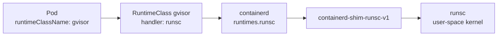

# Lab CKS-10 — Runtime Sandboxing with gVisor

An ordinary container shares the node's kernel, so a kernel exploit inside a container is an exploit of the node. A sandboxed runtime puts another layer in between. gVisor does it with a user-space kernel called `runsc` that answers the container's system calls itself.

Concepts: [[Kubernetes/concepts/L07-security/02-workload-sandboxing/17-runtime-sandboxing|Runtime Sandboxing (gVisor, Kata Containers)]] and [[Containers/runtimes|Container Runtimes]].

Tested on kind v0.31 with Kubernetes v1.35.0 (the version the CKS exam used on 2026-10-13). Not re-run on v1.37; expect small differences in output there.

Verified on `kind` v0.31 with Kubernetes v1.35.0, containerd 2.2 and gVisor release 20261005.



In the exam the runtime is normally installed and configured already, and the task is the RuntimeClass and the Pod. Sections 2 and 3 are still worth doing once, because they make the chain above concrete.

---

## 1. Prerequisites & Starting State

- Working `k8s-lab` cluster from **[[Kubernetes/labs/ckad/01-cluster-setup|Lab CKAD-01]]**.
- A worker node shell:

```bash
docker exec -it k8s-lab-worker bash
```

```bash
# host
kubectl create namespace sandbox-lab
```

---

## 2. Install gVisor on the Node

```bash
# worker node
cd /tmp
URL=https://storage.googleapis.com/gvisor/releases/release/latest/$(uname -m)
curl -fsSLO $URL/gvisor.tar.bz2 -O $URL/gvisor.tar.bz2.sha512
sha512sum -c gvisor.tar.bz2.sha512

apt-get update && apt-get install -y bzip2
tar -xjf gvisor.tar.bz2 -C /usr/local/bin
rm -f gvisor.tar.bz2 gvisor.tar.bz2.sha512
runsc --version
```

The archive holds `runsc`, the shim `containerd-shim-runsc-v1`, and a `gvisor-bin` directory that must stay next to them. Checking the published checksum before unpacking is the "verify platform binaries" objective applied to a runtime.

---

## 3. Register the Runtime with containerd

containerd needs to know that a handler named `runsc` exists and which shim implements it:

```bash
# worker node
cat >> /etc/containerd/config.toml <<'EOF'

        [plugins."io.containerd.grpc.v1.cri".containerd.runtimes.runsc]
          runtime_type = "io.containerd.runsc.v1"
EOF

systemctl restart containerd
crictl info | jq '.config.containerd.runtimes | keys'
```

```text
["runc", "runsc", "test-handler"]
```

The table name ends in the **handler name**. That string is what the RuntimeClass refers to in the next step.

The plugin path in the table name depends on the containerd configuration version. This node's file starts with `version = 2`, which uses `io.containerd.grpc.v1.cri`. A file with `version = 3` uses `io.containerd.cri.v1.runtime` instead. Copy the path from the existing `runc` entry in the file you are editing.

---

## 4. Create the RuntimeClass

```yaml
apiVersion: node.k8s.io/v1
kind: RuntimeClass
metadata:
  name: gvisor
handler: runsc
scheduling:
  nodeSelector:
    sandbox: gvisor
```

```bash
# host
kubectl apply -f runtimeclass.yaml
kubectl label node k8s-lab-worker sandbox=gvisor
kubectl get runtimeclass
```

RuntimeClass is cluster-scoped and has no `spec`: `handler` sits at the top level. The `scheduling.nodeSelector` is merged into every Pod that uses the class, so those Pods only land on nodes where the runtime is actually installed.

---

## 5. Run a Sandboxed Pod

```yaml
apiVersion: v1
kind: Pod
metadata:
  name: sandboxed
  namespace: sandbox-lab
spec:
  runtimeClassName: gvisor
  containers:
    - name: c
      image: busybox:1.36
      command: ["sleep", "3600"]
```

```bash
# host
kubectl apply -f sandboxed.yaml
kubectl -n sandbox-lab run normal --image=busybox:1.36 -- sleep 3600
kubectl -n sandbox-lab get pods -o wide
kubectl -n sandbox-lab get pod sandboxed -o jsonpath='{.spec.runtimeClassName} {.spec.nodeSelector}{"\n"}'
```

```text
gvisor {"sandbox":"gvisor"}
```

The node selector was added by the RuntimeClass, not by you.

---

## 6. Verification

Compare the kernel each Pod sees:

```bash
kubectl -n sandbox-lab exec sandboxed -- uname -r
kubectl -n sandbox-lab exec normal -- uname -r
```

```text
4.19.0-gvisor
6.18.44-1-MANJARO
```

The ordinary Pod reports the node's real kernel. The sandboxed Pod reports gVisor's own.

```bash
kubectl -n sandbox-lab exec sandboxed -- dmesg | head -2
kubectl -n sandbox-lab exec normal -- dmesg
```

```text
[   0.000000] Starting gVisor...
...
dmesg: klogctl: Operation not permitted
```

`dmesg` showing `Starting gVisor...` is the check exam tasks ask for. Confirm it from the node side as well:

```bash
# worker node
crictl inspectp $(crictl pods --name sandboxed -q) | jq -r .status.runtimeHandler
ps -eo comm | grep runsc | sort | uniq -c
```

The sandbox's runtime handler is `runsc`, and `runsc` processes are running on the node.

---

## 7. Controlled Failure Scenario: Two Ways a RuntimeClass Fails

**A class that does not exist** is rejected at admission:

```bash
kubectl -n sandbox-lab run no-class --image=busybox:1.36 --overrides='{"spec":{"runtimeClassName":"nope"}}'
```

```text
Error from server (Forbidden): pods "no-class" is forbidden: pod rejected: RuntimeClass "nope" not found
```

**A class whose handler is not configured on the node** is accepted and fails later:

```bash
cat <<'EOF' | kubectl apply -f -
apiVersion: node.k8s.io/v1
kind: RuntimeClass
metadata:
  name: kata
handler: kata
---
apiVersion: v1
kind: Pod
metadata:
  name: no-handler
  namespace: sandbox-lab
spec:
  runtimeClassName: kata
  containers:
    - name: c
      image: busybox:1.36
      command: ["sleep", "3600"]
EOF
kubectl -n sandbox-lab get pod no-handler
kubectl -n sandbox-lab describe pod no-handler | tail -2
```

```text
no-handler   0/1   ContainerCreating   0   15s
Warning  FailedCreatePodSandBox  ...  no runtime for "kata" is configured
```

The API server knows whether a RuntimeClass object exists. It cannot know whether a node's containerd has the handler. When a Pod sits in `ContainerCreating` with `FailedCreatePodSandBox`, compare the `handler` in the RuntimeClass with the runtime names in `crictl info` on that node, and check that the Pod was scheduled to a node that has it.

---

## 8. What a Sandbox Costs

gVisor intercepts every system call, so it is slower for I/O-heavy and syscall-heavy workloads, and some workloads that need direct kernel features do not run in it at all. That is why sandboxing is applied per workload through a RuntimeClass and not cluster-wide: untrusted or multi-tenant code goes in the sandbox, and trusted, performance-sensitive services stay on `runc`. [[Kubernetes/guides/non-functional/multi-tenancy|Multi-Tenancy]] puts this next to the other isolation tools.

---

## 9. Cleanup

```bash
# host
kubectl delete namespace sandbox-lab
kubectl delete runtimeclass gvisor kata
kubectl label node k8s-lab-worker sandbox-
```

The runtime stays installed on the worker until the cluster is recreated, which does no harm.

---

## Further reading

- [Runtime Class](https://kubernetes.io/docs/concepts/containers/runtime-class/)
- [gVisor installation](https://gvisor.dev/docs/user_guide/install/)
- [gVisor containerd quick start](https://gvisor.dev/docs/user_guide/containerd/quick_start/)

## Next Lab

Proceed to **[[Kubernetes/labs/cks/11-cilium-encryption-and-metadata-protection|Lab CKS-11 — Cilium Encryption & Metadata Protection]]**, or return to the [[Kubernetes/certifications/cks|CKS Track]].
