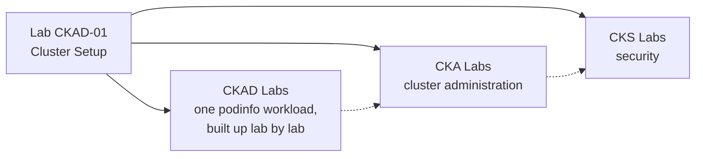

# Kubernetes Hands-On Labs

The labs are grouped by the certification they prepare for. Each one follows the same shape: starting state, step-by-step execution, a controlled failure to diagnose, and cleanup. The study tracks in [[Kubernetes/certifications/index|Kubernetes Certifications]] say which lab covers which exam objective.

| Folder                                    | Labs | Focus                                                                                                                       |
| :---------------------------------------- | :--- | :-------------------------------------------------------------------------------------------------------------------------- |
| [[Kubernetes/labs/ckad/index\|CKAD Labs]] | 13   | Deploying, updating, configuring, exposing and debugging an application; Jobs, Helm, release strategies, quotas and probes  |
| [[Kubernetes/labs/cka/index\|CKA Labs]]   | 12   | Storage, scheduling, autoscaling, `kubeadm`, etcd, certificates, operators, repair and network troubleshooting, Gateway API |
| [[Kubernetes/labs/cks/index\|CKS Labs]]   | 14   | Hardening workloads, the API server and nodes; supply chain; runtime detection; RBAC remediation and investigation          |

Each certification also has a timed practice set: [[Kubernetes/certifications/ckad-mock-exam|CKAD]], [[Kubernetes/certifications/cka-mock-exam|CKA]] and [[Kubernetes/certifications/cks-mock-exam|CKS]].



## How the labs fit together

- **One cluster.** [[Kubernetes/labs/ckad/01-cluster-setup|Lab CKAD-01]] builds the `k8s-lab` cluster that almost every other lab starts from. A lab that needs something else, such as virtual machines or its own cluster, says so in its prerequisites.
- **One shared workload, in five labs only.** Labs CKAD-02 to CKAD-06 are cumulative: they deploy [`podinfo`](https://github.com/stefanprodan/podinfo) (`ghcr.io/stefanprodan/podinfo:6.7.1`) into `default` and each expects the state the previous one left, which every lab states under "Exit State". Do those five in order.
- **Every other lab uses its own namespace** and can be done at any point, with two exceptions: Lab CKA-04 upgrades the cluster Lab CKA-03 installs, and Lab CKA-08 needs the metrics-server that Lab CKAD-06 installs.
- **Node access.** Labs that work on a node use `docker exec -it k8s-lab-control-plane bash` in place of `ssh`.
- **Shared cluster state.** Labs that edit the control plane or the nodes (most CKS labs, CKA-05, CKA-07 and CKA-09) change things every other lab depends on. Do one at a time and finish its cleanup. Each keeps its manifest backup in its own directory under `/root/backup/` on the node.
- **Reset.** If a lab leaves the cluster in a state you cannot repair, delete and recreate it as Lab CKAD-01 describes. That takes about a minute and is always valid.
- **Shape of a lab.** A guided part with real output, one or more controlled failures to diagnose, cleanup, and in the newer labs a "Practice Without the Answer" section with an outcome to reach and a check to run.

---

## Test Environment and What Was Run

The reference environment is **kind v0.33.0 with `kindest/node:v1.37.0`**, kubectl v1.36, on Linux x86-64. Lab CKAD-01 has the host requirements, a preflight check and the pinned image digest. kind v0.31 and older cannot start a v1.37 node.

Each lab states its own test environment near the top. The summary on 2026-10-13:

| Status                                                         | Labs                                                                                                                                               |
| :------------------------------------------------------------- | :------------------------------------------------------------------------------------------------------------------------------------------------- |
| Run on Kubernetes v1.37.0                                      | CKAD-01 to 07 and 09 to 13; CKA-01, 02, 05, 08, 09, 10, 11, 12; CKS-01, 13, 14                                                                     |
| Run on Kubernetes v1.35.0 with kind v0.31, not re-run on v1.37 | CKAD-08; CKA-06, 07; CKS-02 to 12                                                                                                                  |
| Run in parts                                                   | CKA-04: the `kubeadm` upgrade sequence on a kind cluster (v1.36.4 to v1.37.0) and the apt steps in a container, never together on virtual machines |
| Not run                                                        | CKA-03 beyond package installation; the AppArmor section of CKS-05                                                                                 |

"Run" means the commands were executed and the output shown was captured from that run, apart from names and addresses that differ on every cluster. It does not mean every sentence was verified, and it says nothing about other operating systems or architectures. Pod names, IP addresses, ages and hashes in the output will differ on your cluster.

| Component              | Specification                                               |
| :--------------------- | :---------------------------------------------------------- |
| **Local cluster**      | `kind` v0.33.0                                              |
| **Kubernetes version** | `v1.37.0`, pinned by image digest                           |
| **kubectl**            | Within one minor version of the cluster (v1.36 to v1.38)    |
| **Sample application** | `ghcr.io/stefanprodan/podinfo:6.7.1`                        |
| **Topology**           | 1 control plane + 2 workers, labelled `zone-a` and `zone-b` |

### Cluster configuration

Save this as `kind-config.yaml`. The same file is in the repository at `content/Kubernetes/labs/kind-config.yaml`:

```yaml
kind: Cluster
apiVersion: kind.x-k8s.io/v1alpha4
name: k8s-lab
nodes:
  - role: control-plane
    labels:
      ingress-ready: "true"
    extraPortMappings:
      - containerPort: 80
        hostPort: 80
        protocol: TCP
      - containerPort: 443
        hostPort: 443
        protocol: TCP
      - containerPort: 30080
        hostPort: 30080
        protocol: TCP
      - containerPort: 30443
        hostPort: 30443
        protocol: TCP
  - role: worker
    labels:
      topology.kubernetes.io/zone: "zone-a"
  - role: worker
    labels:
      topology.kubernetes.io/zone: "zone-b"
```

```bash
kind create cluster --config kind-config.yaml \
  --image kindest/node:v1.37.0@sha256:a1ed56cfb0e7b93589bdf97c8cd566405a265939e3620fc4f5de89adff580ae5
kubectl cluster-info --context kind-k8s-lab
```

To remove it:

```bash
kind delete cluster --name k8s-lab
```

---

## Next Steps

Begin with **[[Kubernetes/labs/ckad/01-cluster-setup|Lab CKAD-01 — Cluster Setup & Orientation]]**.
